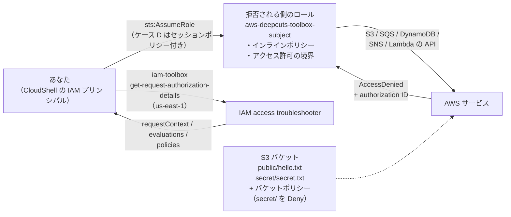

このリポジトリは AWS Deep Cuts の、IAM Toolbox（IAM access troubleshooter）に関するハンズオンコンテンツです。

<!-- TODO: 記事公開後にリンクを追加 -->
<!-- IAM Toolbox の解説記事(AWS Builder Center)は[こちら]() -->

解説記事の原稿は [article/aws-iam-toolbox.md](./article/aws-iam-toolbox.md) にあります。

> **Note**: このハンズオンは 2026 年 8 月 25 日からプレビュー提供されている **IAM access troubleshooter**（API 名: IAM Toolbox の `GetRequestAuthorizationDetails`）を使用します。2026 年 10 月時点では **米国東部（バージニア北部、`us-east-1`）のみ** で提供されており、拒否が起きたのと同じリージョンで照会する必要があるため、ハンズオンはすべて `us-east-1` で行います。プレビュー機能のため、仕様は今後変わる可能性があります。
>
> AWS CLI は `aws iam-toolbox` サブコマンドに対応したバージョン（2026 年 8 月 25 日以降にリリースされた AWS CLI v2）が必要です。CloudShell には最新版が入っています。

> 💰 **コストについて**
>
> このハンズオンで作成するのは IAM ロール・IAM ポリシー・数 KB のオブジェクトを入れた S3 バケットだけで、料金は実質 0 円です。API の呼び出しにも料金はかかりません。それでも、検証が終わったら後片付けを実施してください。

# AWS Deep Cutsとは
AWS Deep Cutsは、AWS の最新のサービスやニッチな機能、または高度にアカデミックな知識を要求するサービスなど、多くの人が知らない 『隠れた名曲 = **Deep Cuts**』 を深くまで掘り下げる技術シリーズです。

このようなサービスはWeb情報も少なく、初学者は気軽にキャッチアップできないのが実情です。

そこで AWS Deep Cuts シリーズでは、**前提知識も含めた分かりやすいサービス解説** と **手順通りに進めれば誰でも再現できるハンズオン** を提供します！

# ハンズオンのゴール

このハンズオンでは「**AccessDenied 図鑑**」を作ります。原因の違う 6 種類の AccessDenied をわざと起こし、エラーメッセージに含まれる **authorization ID** から、IAM が **どのポリシーをどう評価してその結論に至ったのか** を取得して読み解きます。

| ケース | 拒否の原因 | 期待する評価結果 |
| --- | --- | --- |
| A | 暗黙の拒否（どのポリシーにも Allow が無い） | `IMPLICIT_DENY`、マッチしたポリシーなし |
| B | ID ベースポリシーの明示的 Deny | `EXPLICIT_DENY`、Sid `DenyListAllMyBuckets` が `DENY` |
| C | アクセス許可の境界（ID ベースポリシーは Allow しているのに、境界に無い） | `IMPLICIT_DENY`、ID ベースポリシーは `ALLOW` でマッチ、境界が評価対象に含まれる |
| D | セッションポリシーの明示的 Deny | `EXPLICIT_DENY`、`SESSION_POLICY` が `DENY` |
| E | リソースベースポリシー（S3 バケットポリシー）の明示的 Deny | `EXPLICIT_DENY`、`RESOURCE_BASED_POLICY` が `DENY`、ID ベースポリシーは `ALLOW` |
| F | 1 つのリクエストで複数のアクションが評価される（`lambda:CreateFunction` + `iam:PassRole`） | evaluations が 2 件、`iam:PassRole` だけ `IMPLICIT_DENY` |

ケースごとに、以下を確認します。

1. エラーメッセージのどこに authorization ID が入っているか
2. `get-request-authorization-details` の応答（リクエストコンテキスト、評価、評価対象のポリシー）の構造
3. 応答が IAM のポリシー評価ロジック（明示的 Deny → SCP／RCP → リソースベース → アクセス許可の境界 → セッションポリシー → ID ベース）とどう対応するか

# ハンズオン手順

以降の手順は、ハンズオン用に用意した AWS アカウントで実施してください。

## 前提条件

- AWS CloudShell を **バージニア北部（us-east-1）** で開くこと
- 実行する IAM プリンシパルに、IAM ロール／ポリシーの作成・削除、S3 バケットの作成・削除、作成したロールへの `sts:AssumeRole`、そして `iam:GetRequestAuthorizationDetails` の権限があること（`AdministratorAccess` 相当で実施するのが簡単です）
- このハンズオンは単一アカウントで完結します。AWS Organizations の SCP／RCP による拒否は扱いません（記事で解説しています）

<details>
<summary>最小権限に近い IAM ポリシー例（実行者用）</summary>

```json
{
  "Version": "2012-10-17",
  "Statement": [
    {
      "Sid": "AccessTroubleshooter",
      "Effect": "Allow",
      "Action": "iam:GetRequestAuthorizationDetails",
      "Resource": "*"
    },
    {
      "Sid": "SubjectRole",
      "Effect": "Allow",
      "Action": [
        "iam:CreateRole", "iam:GetRole", "iam:DeleteRole", "iam:TagRole",
        "iam:PutRolePolicy", "iam:DeleteRolePolicy",
        "iam:PutRolePermissionsBoundary", "iam:DeleteRolePermissionsBoundary",
        "sts:AssumeRole"
      ],
      "Resource": "arn:aws:iam::*:role/aws-deepcuts-toolbox-subject"
    },
    {
      "Sid": "BoundaryPolicy",
      "Effect": "Allow",
      "Action": ["iam:CreatePolicy", "iam:GetPolicy", "iam:DeletePolicy", "iam:TagPolicy"],
      "Resource": "arn:aws:iam::*:policy/aws-deepcuts-toolbox-boundary"
    },
    {
      "Sid": "Bucket",
      "Effect": "Allow",
      "Action": [
        "s3:CreateBucket", "s3:DeleteBucket", "s3:PutPublicAccessBlock", "s3:PutBucketPolicy",
        "s3:PutObject", "s3:GetObject", "s3:DeleteObject", "s3:ListBucket"
      ],
      "Resource": ["arn:aws:s3:::aws-deepcuts-toolbox-*", "arn:aws:s3:::aws-deepcuts-toolbox-*/*"]
    },
    {
      "Sid": "Identity",
      "Effect": "Allow",
      "Action": "sts:GetCallerIdentity",
      "Resource": "*"
    }
  ]
}
```
</details>

## 構築するアーキテクチャ



- `setup.sh` が「拒否される側」のロールと、拒否の原因になるポリシー・バケットを仕込みます。
- `denied.sh` がロールを引き受けて拒否されるコマンドを実行し、authorization ID を抜き出して `get-request-authorization-details` を呼び、`explain.py` で読み解きます。
- authorization ID の照会は、拒否された本人ではなく **あなた（実行者）の権限** で行います。拒否される側のロールには `iam:GetRequestAuthorizationDetails` を与えていません。

以降、各種コマンドは[CloudShell](https://docs.aws.amazon.com/cloudshell/latest/userguide/welcome.html)（**us-east-1**）で実行してください。

## １．事前準備

```bash
# このリポジトリをクローン
git clone https://github.com/AWS-Deep-Cuts/aws-iam-toolbox
cd aws-iam-toolbox/hands-on

# セットアップスクリプトの実行
bash ./setup.sh

# 以下の文言が表示されればセットアップ成功です
# ✅ セットアップが完了しました！
```

setup.sh は以下のリソースを作成します。

| リソース | 役割 |
| --- | --- |
| 顧客管理ポリシー `aws-deepcuts-toolbox-boundary` | アクセス許可の境界。S3・SQS・SNS・Lambda・`iam:PassRole`・STS は許可するが、**DynamoDB を含まない**（ケース C） |
| IAM ロール `aws-deepcuts-toolbox-subject` | 拒否される側。信頼ポリシーは自アカウントの root（実行者が `sts:AssumeRole` できる） |
| ロールのインラインポリシー | `AllowReadHandsOnBucket`（バケットの読み取りを Allow）、`DenyListAllMyBuckets`（ケース B）、`AllowDynamoDBListTables`（ケース C）、`AllowSNSListTopics`（ケース D）、`AllowCreateFunctionWithoutPassRole`（ケース F） |
| S3 バケット `aws-deepcuts-toolbox-<アカウント ID>-<日時>` | `public/hello.txt` と `secret/secret.txt`。バケットポリシーで、このロールからの `secret/*` の `s3:GetObject` を明示的に Deny（ケース E） |

## ２．図鑑を実行する

```bash
bash ./denied.sh

# ケース 1 つだけ実行したい場合
bash ./denied.sh C

# 以下の文言が表示されれば成功です
# ✅ 図鑑の実行が完了しました！
```

denied.sh は最初に「対照実験」として、許可されている操作（`public/hello.txt` の取得）が成功することを確認します。その後、ケース A〜F を順に実行します。各ケースの出力は次の順です。

1. 実行したコマンドと、返ってきたエラーメッセージ全文
2. エラーメッセージから抜き出した authorization ID
3. `get-request-authorization-details` の応答を `explain.py` で整形したもの（生の JSON は `output/<ケース>.json`）

> **この手順で確かめること**
> - **やること**: ケース A〜F の出力を上から読みます。
> - **期待する結果**: 各ケースで、「ハンズオンのゴール」の表にある評価結果が返ります。
> - **ここから分かること**: 次の 3 点です。

---

#### 観点 1: authorization ID はエラーメッセージの一部である

> **この観点で確かめること**
> - **やること**: ケース A のエラーメッセージを、ID の部分まで含めて読みます。
> - **期待する結果**: 従来の「`User: ... is not authorized to perform: sqs:ListQueues ... because no identity-based policy allows ...`」という文に加えて、authorization ID（英小文字と数字）と、コンソールの Access Troubleshooter へのリンクが含まれています。
> - **ここから分かること**: ID はサーバー側に保存された「その拒否の評価記録」への参照です。ID だけでは何も分からず、`iam:GetRequestAuthorizationDetails` 権限を持つ人がその ID を照会して初めて中身が見えます。対応していないサービス・API では ID が付かないことがあります（AWS は ID の付与を保証していません）。

---

#### 観点 2: 「暗黙の拒否」と「明示的な拒否」は応答の形が違う

> **この観点で確かめること**
> - **やること**: ケース A（暗黙）とケース B（明示的）の `evaluations` を見比べます。
> - **期待する結果**: A は `evaluatedEffect: IMPLICIT_DENY` で `matchedPolicies` が空、B は `EXPLICIT_DENY` で `matchedStatements` に Sid `DenyListAllMyBuckets` と `DENY` が入っています。
> - **ここから分かること**: 暗黙の拒否は「マッチしたものが無い」ことの結果なので、犯人を名指しできません。代わりに `policies` に「評価対象になったポリシー」が並ぶので、「ここに Allow を足せばよい」と分かります。明示的な拒否は、ポリシーとステートメントまで名指しされます。

---

#### 観点 3: 「誰も Deny していないのに拒否される」を可視化する

> **この観点で確かめること**
> - **やること**: ケース C（境界）とケース D（セッションポリシー）、ケース E（バケットポリシー）の `policies` の `type` を見ます。
> - **期待する結果**: C では ID ベースポリシーが `ALLOW` でマッチしているのに全体は `IMPLICIT_DENY` で、`policies` に `PERMISSIONS_BOUNDARY` が含まれます。D では `SESSION_POLICY`、E では `RESOURCE_BASED_POLICY` が `DENY` でマッチします。
> - **ここから分かること**: IAM のポリシー評価は、ID ベースポリシーだけで決まりません。境界・セッションポリシーは「許可を絞る層」で、その層に Allow が無ければ暗黙の拒否になります。`explain.py` の「読み方」行は、この構造に沿って真犯人を推定しています。

---

#### 観点 4: 1 つの API 呼び出しが複数の評価になる

> **この観点で確かめること**
> - **やること**: ケース F の `evaluations` の件数を見ます。
> - **期待する結果**: `lambda:CreateFunction` は `ALLOW`、`iam:PassRole` は `IMPLICIT_DENY` の 2 件です。
> - **ここから分かること**: `CreateFunction` にロールを渡すとき、Lambda は `iam:PassRole` も評価します。従来のエラーメッセージでは「PassRole が無い」としか分かりませんでしたが、評価の一覧を見ると「関数の作成自体は許可されていた」ことまで分かります。

---

## ３．コンソールで見る（任意）

エラーメッセージに含まれるリンクを開くと、IAM コンソールの **Access Troubleshooter** 画面で同じ評価結果を見られます（コンソールにサインインしているプリンシパルに `iam:GetRequestAuthorizationDetails` が必要です）。

## ４．後片付け

検証が終わったら、リソースを削除しましょう。

CloudShellで以下のコマンドを実行することで、今回作成したリソースを綺麗に削除することができます！

```bash
cd aws-iam-toolbox/hands-on
bash ./cleanup.sh

# 以下の文言が表示されればクリーンアップ成功です
# ✅ すべてのリソースの削除が完了しました！

cd ../..
sudo rm -rf aws-iam-toolbox
```

## トラブルシューティング

| 表示されるエラー | 主な原因 | 対処 |
| -- | -- | -- |
| `iam-toolbox コマンドに対応していません` | AWS CLI が古い | AWS CLI v2 を最新版に更新する。CloudShell なら新しいセッションを開く |
| `assume-role` が `AccessDenied` | 実行者に `sts:AssumeRole` が無い、またはロール作成直後で伝播していない | 権限を確認する。10〜20 秒待って再実行する |
| `拒否されませんでした（期待と異なります）` | ポリシーの伝播待ち | 10〜20 秒待って `bash ./denied.sh <ケース>` を再実行する |
| `authorization ID が含まれていません` | そのサービス／API が authorization ID に対応していない、または ID が付与されなかった | 別のサービスで試す。記事の「対応サービス」を参照 |
| `ResourceNotFoundException` | 反映前に照会した、または拒否が起きたリージョンと違うリージョンで照会した | denied.sh は自動で再試行します。手動の場合は数秒待ち、`--region us-east-1` を確認する |
| `get-request-authorization-details` が `AccessDeniedException` | 実行者に `iam:GetRequestAuthorizationDetails` が無い | 実行者のポリシーに追加する（拒否される側のロールではなく、あなたの権限） |

## 参考リンク

- [Troubleshoot access denied error messages with authorization ID (Preview)](https://docs.aws.amazon.com/IAM/latest/UserGuide/troubleshoot_access-denied-authorization-id.html)
- [GetRequestAuthorizationDetails - IAM Toolbox API Reference](https://docs.aws.amazon.com/iam-toolbox/latest/APIReference/API_GetRequestAuthorizationDetails.html)
- [Troubleshoot access denied error messages](https://docs.aws.amazon.com/IAM/latest/UserGuide/troubleshoot_access-denied.html)
- [Policy evaluation logic](https://docs.aws.amazon.com/IAM/latest/UserGuide/reference_policies_evaluation-logic.html)
- [AWS CLI `iam-toolbox` リファレンス](https://docs.aws.amazon.com/cli/latest/reference/iam-toolbox/)
