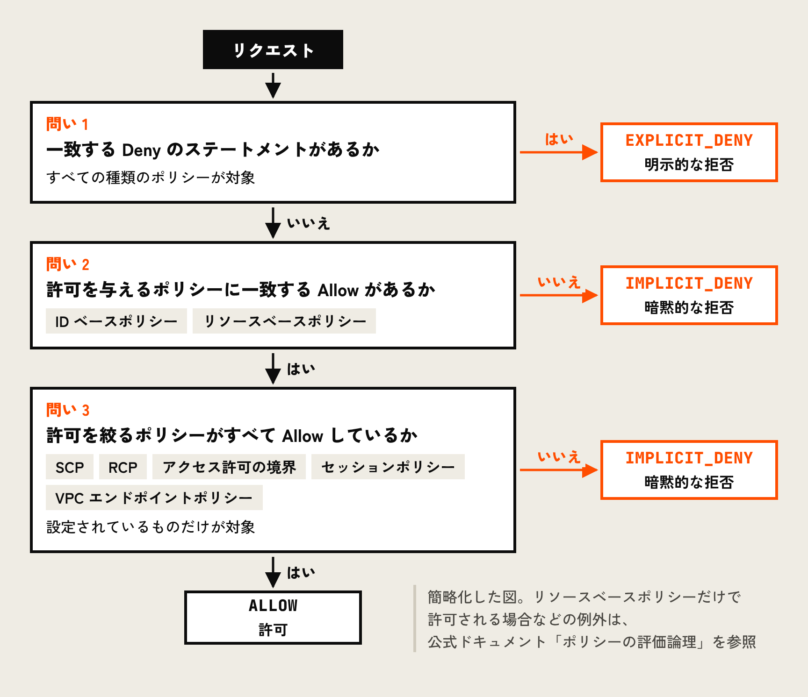
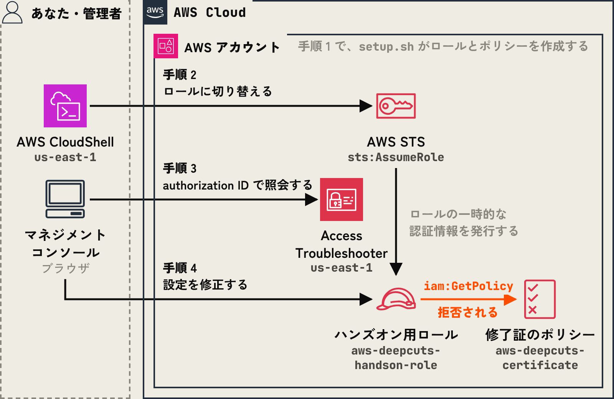
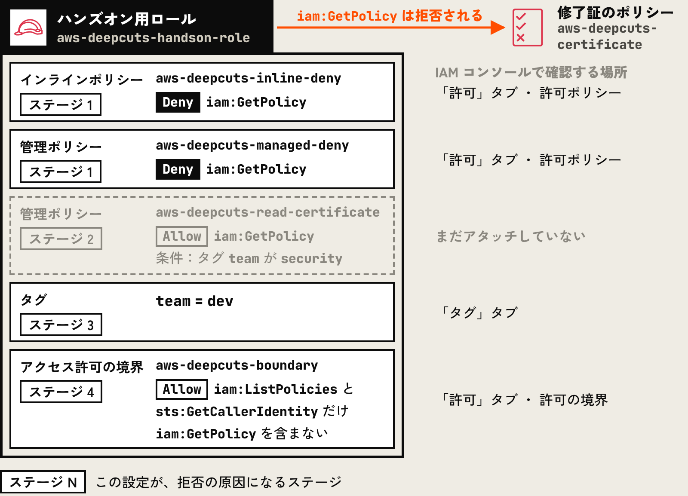
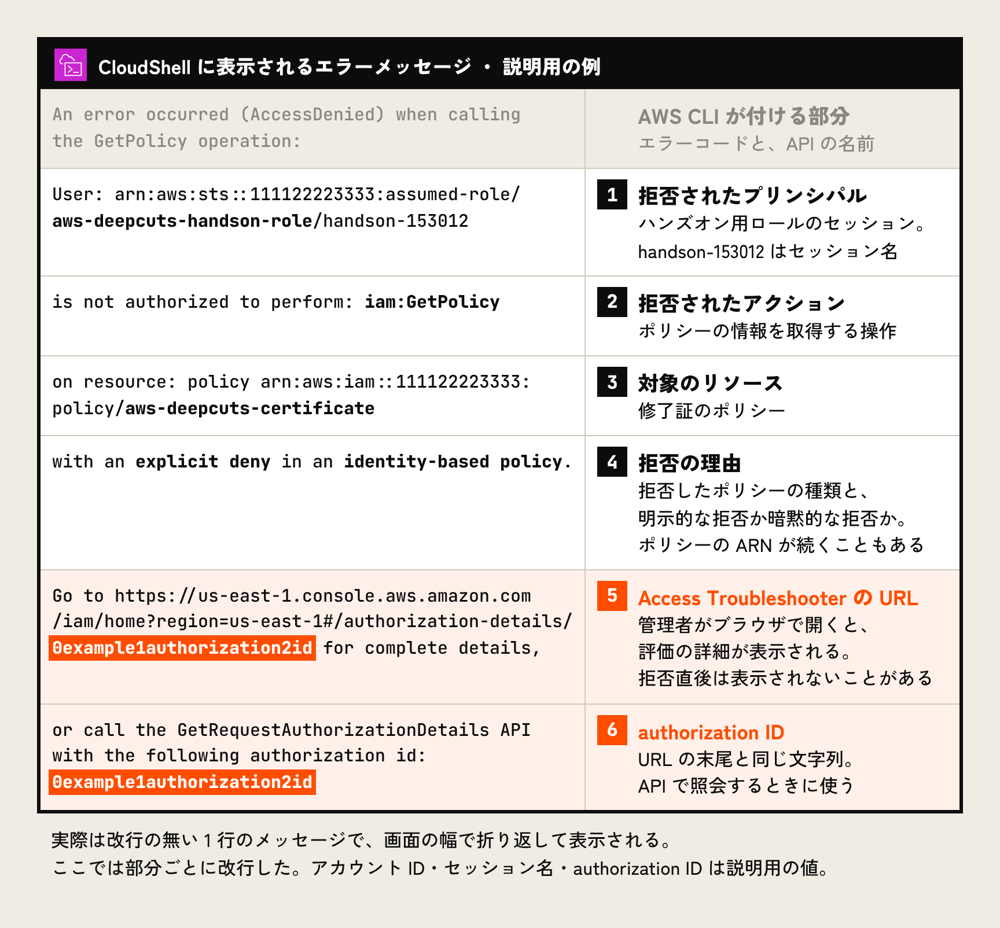
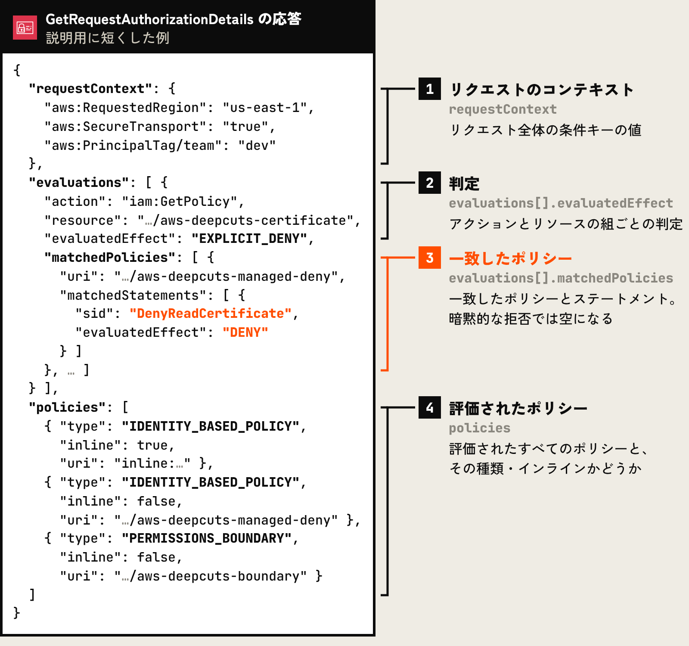
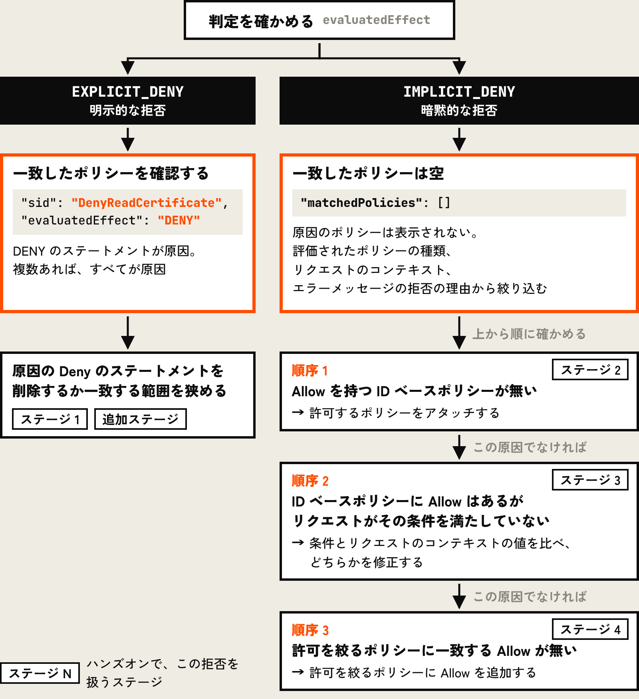
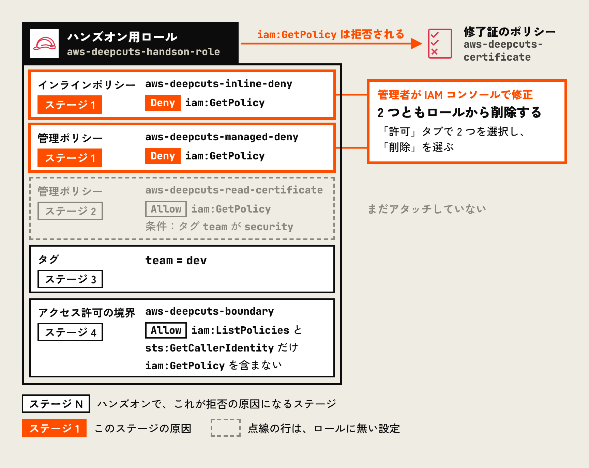
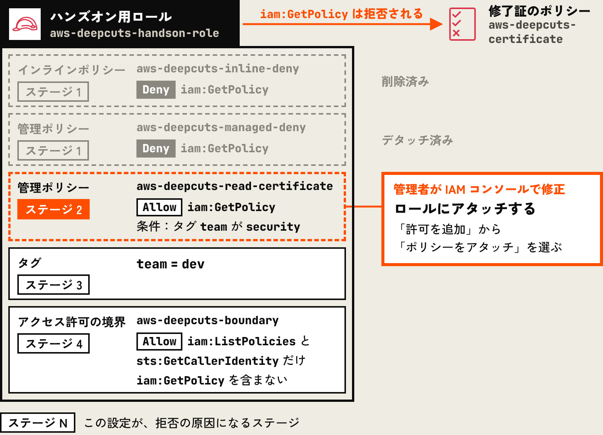
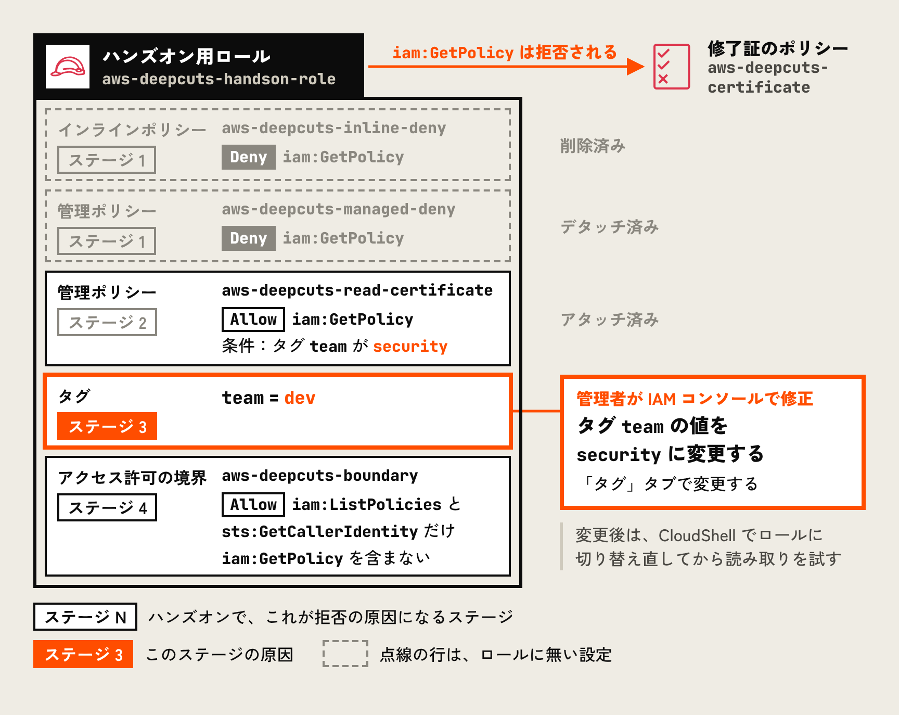
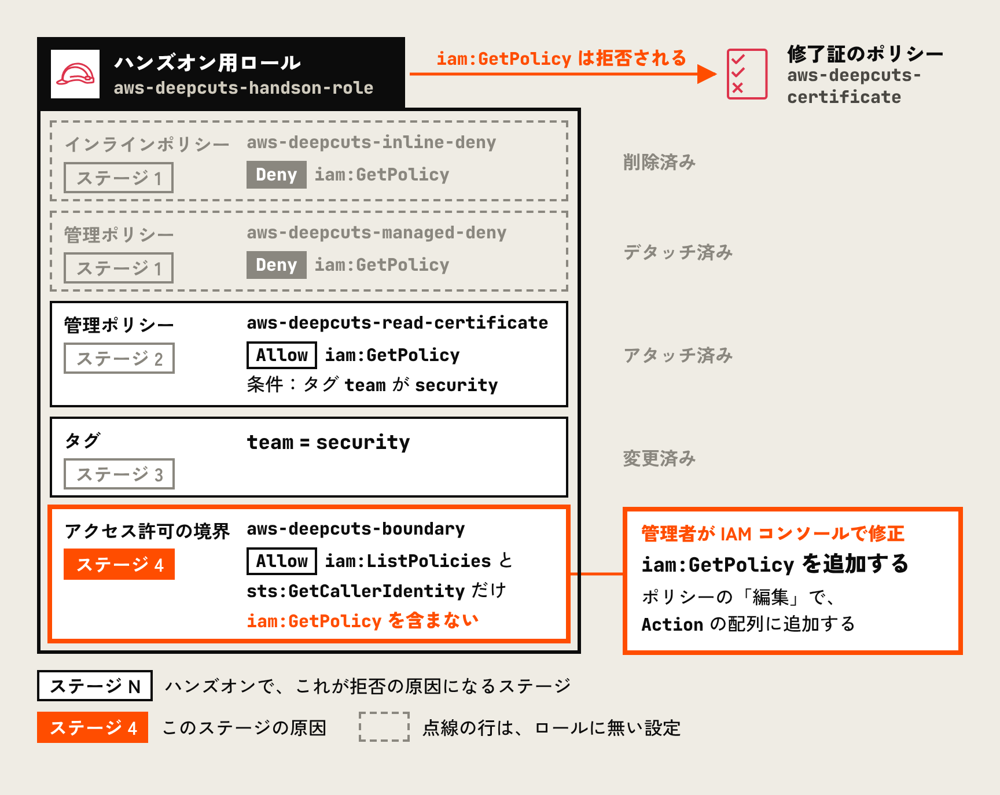

このリポジトリは AWS Deep Cuts の、IAM Access Troubleshooter に関するハンズオンコンテンツです。

<!-- TODO: 記事の公開後に、次の行のリンクを有効にする -->
<!-- IAM Access Troubleshooter の解説記事(Qiita)は[こちら]() -->

解説記事の原稿は [article/aws-iam-toolbox.md](./article/aws-iam-toolbox.md) にあります。

<!-- TODO（公開前に著者が確認）: ステージ 1〜4 と追加ステージのそれぞれで、iam:GetPolicy の拒否のエラーメッセージに authorization ID とコンソールの URL が付くことを実機で確かめ、確かめた日付を下の Note に書く -->

> **Note**: IAM Access Troubleshooter は、2026 年 8 月にプレビューとして提供が始まった機能で、2026 年 10 月時点でもプレビューです。画面や仕様は、今後変わる可能性があります。
> - AWS SDK と AWS CLI のリリースノートによると、プレビューを提供するリージョンは、**バージニア北部（`us-east-1`）だけ** です。2026 年 10 月時点で、東京リージョンでの提供は発表されていません。拒否が起きたのと同じリージョンで照会する必要があるため、このハンズオンはすべて `us-east-1` で実施します。
> - 公式ドキュメントによると、拒否されたリクエストを識別する authorization ID がエラーメッセージに付くのは、主に IAM（AWS Identity and Access Management）の API です。そのため、このハンズオンでは IAM のポリシーを読み取る操作を題材にします。
>
> この機能は、使う場所によって名前が異なります。この README では、Access Troubleshooter と呼びます。
>
> | 使う場所 | 名前 |
> | --- | --- |
> | マネジメントコンソール | Access Troubleshooter |
> | API | IAM Toolbox の `GetRequestAuthorizationDetails` |
> | AWS CLI | `aws iam-toolbox get-request-authorization-details` |
> | IAM ポリシーのアクション | `iam:GetRequestAuthorizationDetails` |
>
> API と AWS CLI では、この機能は IAM Toolbox という名前で提供されています。そのため、AWS CLI のコマンドは `aws iam` ではなく `aws iam-toolbox` で始まります。一方、この API を呼び出す権限の名前は、IAM の `iam:GetRequestAuthorizationDetails` です。

> 💰 **コストについて**
>
> 作成するのは IAM のロールとポリシーだけです。IAM、ロールの切り替えに使う AWS STS（AWS Security Token Service）、CloudShell は、追加料金なしで使えます。Access Troubleshooter に固有の料金は、2026 年 10 月時点で、ドキュメントにも価格表にも載っていません。それでも、終わったら後片付けをしてください。

# AWS Deep Cutsとは
AWS Deep Cutsは、AWS の最新のサービスやニッチな機能、または高度にアカデミックな知識を要求するサービスなど、多くの人が知らない 『隠れた名曲 = **Deep Cuts**』 を深くまで掘り下げる技術シリーズです。

このようなサービスはWeb情報も少なく、初学者は気軽にキャッチアップできないのが実情です。

そこで AWS Deep Cuts シリーズでは、**前提知識も含めた分かりやすいサービス解説** と **手順通りに進めれば誰でも再現できるハンズオン** を提供します！

# ハンズオンのゴール

このハンズオンでは、IAM がリクエストを拒否する 4 種類の原因を、ステージとして 1 つずつ特定して解消します。

IAM は、リクエストを拒否すると、エラーメッセージの最後に **authorization ID** を付けます。authorization ID は、IAM が拒否したリクエストを 1 件ずつ識別する ID です。この ID を Access Troubleshooter で照会すると、IAM がそのリクエストをどう評価したかの記録を確認できます。この記録を **評価の詳細** と呼びます。

あなたは、ハンズオン用の IAM ロール `aws-deepcuts-handson-role` に切り替えて、IAM のポリシー `aws-deepcuts-certificate` の説明文を読み取ります。この説明文には、ハンズオンの修了証が書かれています。ただし、事前準備で実行する `setup.sh` は、このロールで読み取りが拒否される原因を 4 種類用意します。拒否されるたびに、あなたはエラーメッセージの authorization ID で評価の詳細を開いて原因を特定し、IAM コンソールで設定を修正します。4 つのステージをクリアすると、修了証を読み取れます。この README では、`aws-deepcuts-handson-role` をハンズオン用ロール、`aws-deepcuts-certificate` を修了証のポリシーと呼びます。

IAM のポリシーは、1 つ以上のステートメントからなります。ステートメントは、ポリシーの中の 1 つの規則です。ステートメントには、許可するか拒否するかを Allow か Deny で表す Effect、対象の操作を表す Action、対象のリソースを表す Resource を書きます。必要に応じて、条件を表す Condition も書きます。各ステートメントには、区別のための ID である Sid（Statement ID）を付けられます。

IAM の権限を決めるポリシーには、許可を与えるポリシーと、許可を絞るポリシーがあります。許可を与えるポリシーは、ID ベースポリシーとリソースベースポリシーです。ID ベースポリシーは、IAM のユーザーやロールに設定するポリシーで、IAM コンソールのロールの画面では「許可ポリシー」として表示されます。許可を与えるポリシーに分類される ID ベースポリシーにも、Deny のステートメントを書けます。リソースベースポリシーは、S3 バケットなどのリソースに設定するポリシーです。

許可を絞るポリシーは、アクセス許可の境界・セッションポリシー・SCP（サービスコントロールポリシー）・RCP（リソースコントロールポリシー）・VPC エンドポイントポリシーです。許可を絞るポリシーの Allow は、操作を許可するのではなく、許可できる操作の上限を定めます。たとえば、アクセス許可の境界は、ロールが行える操作の上限を定めるポリシーです。セッションポリシーは、ロールに切り替えるときに渡すポリシーで、切り替えた後に行える操作の上限を定めます。

ポリシーは、作成のしかたによって、管理ポリシーとインラインポリシーにも分かれます。管理ポリシーは、独立して作成し、複数のユーザーやロールにアタッチできるポリシーです。インラインポリシーは、1 つのユーザーやロールの中に直接書き込むポリシーです。

IAM がポリシーを評価する順序を簡略化すると、次の図のようになります。



図の `EXPLICIT_DENY`・`IMPLICIT_DENY`・`ALLOW` は、IAM の評価の結論を表す値で、評価の詳細にも含まれます。この README では、この値を判定と呼びます。

問い 1 では、リクエストに一致する Deny のステートメントがあるかを確かめます。ステートメントがリクエストに一致するとは、ステートメントの Action と Resource がリクエストの操作と対象に当てはまり、Condition があればその条件も満たすことです。一致する Deny があれば、IAM はリクエストを拒否します。これを **明示的な拒否** と呼びます。問い 2 では、許可を与えるポリシーに、一致する Allow のステートメントがあるかを確かめます。問い 3 では、設定されている許可を絞るポリシーのそれぞれに、一致する Allow のステートメントがあるかを確かめます。問い 2 か問い 3 で、必要な Allow が無いために拒否されることを、**暗黙的な拒否** と呼びます。4 つのステージの拒否は、この順序で 1 つずつ現れます。

| ステージ | 拒否の原因 | 拒否される問い |
| --- | --- | --- |
| 1 | ロールのポリシーに、読み取りを拒否する Deny のステートメントが 2 つある | 問い 1・明示的な拒否 |
| 2 | 読み取りを許可するポリシーが、ロールに無い | 問い 2・暗黙的な拒否 |
| 3 | 許可するポリシーはあるが、その条件をロールのタグが満たしていない | 問い 2・暗黙的な拒否 |
| 4 | アクセス許可の境界が、読み取りを許可していない | 問い 3・暗黙的な拒否 |

このハンズオンを終えると、次の 3 つができるようになります。

1. `AccessDenied` のエラーメッセージから authorization ID を見つけ、Access Troubleshooter で評価の詳細を表示できる
2. 評価の詳細の 4 つの項目から、拒否の原因を特定できる
3. 明示的な拒否と暗黙的な拒否を区別し、それぞれの原因を調べられる

# ハンズオン手順

以降の手順は、ハンズオン用に用意した AWS アカウントで実施してください。

## 構築するアーキテクチャ



この README では、CloudShell とマネジメントコンソールにサインインしているあなた自身のユーザー、つまり IAM ユーザーまたは IAM Identity Center のユーザーを「管理者」と呼びます。ハンズオン用ロールに切り替えている間を除き、操作はすべて管理者として行います。

- あなたは CloudShell から AWS STS にロールの切り替えを依頼し、ハンズオン用ロールの一時的な認証情報で、修了証のポリシーの読み取りを試します。
- 読み取りが拒否されると、IAM はエラーメッセージに authorization ID を付けて返します。IAM は、エラーを返す処理とは別に、評価の詳細を記録します。
- あなたは管理者として、ブラウザのマネジメントコンソールで Access Troubleshooter を開き、評価の詳細を確認します。そして、IAM コンソールでロールやポリシーを修正します。

## 前提条件

- AWS CloudShell を **バージニア北部（us-east-1）** で開くこと
- ルートユーザーではなく、IAM ユーザーまたは IAM Identity Center のユーザーでサインインしていること。ルートユーザーはロールに切り替えられないため、このハンズオンを実施できません。
- CloudShell を開いたブラウザの別のタブで、IAM コンソールと Access Troubleshooter の画面を表示できること。CloudShell は、マネジメントコンソールにサインインしているユーザーの権限で動きます。
- 実行するユーザーに、IAM のロールとポリシーの作成・変更・削除、作成したロールへの `sts:AssumeRole`、`iam:GetRequestAuthorizationDetails`、CloudShell を使う権限があること。`AdministratorAccess` 相当の権限で実施するのが簡単です。

<details>
<summary>最小権限に近い IAM ポリシーの例</summary>

CloudShell を使う権限は、このポリシーとは別に必要です。たとえば、AWS 管理ポリシーの `AWSCloudShellFullAccess` をアタッチします。

```json
{
  "Version": "2012-10-17",
  "Statement": [
    {
      "Sid": "AccessTroubleshooter",
      "Effect": "Allow",
      "Action": "iam:GetRequestAuthorizationDetails",
      "Resource": "*"
    },
    {
      "Sid": "HandsOnRole",
      "Effect": "Allow",
      "Action": [
        "iam:CreateRole", "iam:GetRole", "iam:DeleteRole", "iam:TagRole", "iam:UntagRole", "iam:ListRoleTags",
        "iam:PutRolePolicy", "iam:GetRolePolicy", "iam:DeleteRolePolicy", "iam:ListRolePolicies",
        "iam:AttachRolePolicy", "iam:DetachRolePolicy", "iam:ListAttachedRolePolicies",
        "iam:PutRolePermissionsBoundary", "iam:DeleteRolePermissionsBoundary",
        "sts:AssumeRole"
      ],
      "Resource": "arn:aws:iam::*:role/aws-deepcuts-handson-role"
    },
    {
      "Sid": "ManagedPolicies",
      "Effect": "Allow",
      "Action": [
        "iam:CreatePolicy", "iam:GetPolicy", "iam:DeletePolicy", "iam:TagPolicy", "iam:ListEntitiesForPolicy",
        "iam:CreatePolicyVersion", "iam:DeletePolicyVersion", "iam:ListPolicyVersions", "iam:GetPolicyVersion", "iam:SetDefaultPolicyVersion"
      ],
      "Resource": "arn:aws:iam::*:policy/aws-deepcuts-*"
    },
    {
      "Sid": "ConsoleAndIdentity",
      "Effect": "Allow",
      "Action": ["iam:ListPolicies", "iam:ListRoles", "sts:GetCallerIdentity"],
      "Resource": "*"
    }
  ]
}
```
</details>

## ハンズオンの進め方

各ステージは、次の 4 つの操作の繰り返しです。CloudShell とブラウザの 2 つの画面を行き来します。

| 操作 | 画面 | 誰として操作するか |
| --- | --- | --- |
| ① 修了証のポリシーの読み取りを試す | CloudShell | ハンズオン用ロール |
| ② 拒否されたら、authorization ID で評価の詳細を開き、原因を特定する | ブラウザの Access Troubleshooter | 管理者 |
| ③ 原因になっている設定を修正する | ブラウザの IAM コンソール | 管理者 |
| ④ もう一度 ① を実行する | CloudShell | ハンズオン用ロール |

ハンズオン用ロールに `"Action": "*"` のような広い許可を追加して解決することは避けてください。いくつかの拒否がまとめて解消され、原因を 1 つずつ特定する練習ができなくなります。

> **Note**: ハンズオン用ロールへの切り替えと、コマンドで使う `CERT_ARN` などの変数は、`source ./switch-role.sh` を実行した CloudShell のタブの中だけで有効です。CloudShell は、操作しない時間が続くと、シェルを終了します。シェルが終了したとき、または新しいタブを開いたときは、次のコマンドを実行してから続けてください。手順 3 の「CLI で評価の詳細を取得する方法」で AWS CLI をホームディレクトリにインストールした場合は、先に `export PATH="$HOME/.local/bin:$PATH"` を実行します。
>
> ```bash
> cd ~/aws-iam-toolbox/hands-on
> source ./switch-role.sh
> ```
>
> ハンズオン用ロールの一時的な認証情報は、切り替えから 1 時間で失効します。`ExpiredToken` と表示されたら、`source ./switch-role.sh` を実行し直してください。

以降、各種コマンドは[CloudShell](https://docs.aws.amazon.com/cloudshell/latest/userguide/welcome.html)（**us-east-1**）で実行してください。

## １．事前準備

`setup.sh` で、ハンズオン用ロールを作成し、読み取りが拒否される原因を 4 種類用意します。

```bash
# このリポジトリをクローン
git clone https://github.com/AWS-Deep-Cuts/aws-iam-toolbox
cd aws-iam-toolbox/hands-on

# セットアップスクリプトの実行
bash ./setup.sh

# 以下の文言が表示されればセットアップ成功です
# ✅ セットアップが完了しました！
```

`setup.sh` は、次のリソースを作成し、名前と ARN を `resource-ids.env` に保存します。ARN（Amazon Resource Name）は、AWS のリソースを一意に識別するための名前です。

| リソース | 名前 | 内容 | 関係するステージ |
| --- | --- | --- | --- |
| 管理ポリシー | `aws-deepcuts-certificate` | 修了証のポリシー。説明文に修了証が書かれている。本文はすべての操作を Deny する内容のため、ロールにアタッチしない | ゴール |
| IAM ロール | `aws-deepcuts-handson-role` | ハンズオン用ロール。タグ `team` の値は `dev`。アクセス許可の境界に `aws-deepcuts-boundary` を設定 | すべて |
| インラインポリシー | `aws-deepcuts-inline-deny` | ハンズオン用ロールの中に直接書き込まれたポリシー。修了証のポリシーへの `iam:GetPolicy` を Deny する | 1 |
| 管理ポリシー | `aws-deepcuts-managed-deny` | ハンズオン用ロールにアタッチ済み。修了証のポリシーへの `iam:GetPolicy` を Deny する | 1 |
| 管理ポリシー | `aws-deepcuts-read-certificate` | 修了証のポリシーへの `iam:GetPolicy` を Allow する。ただし、ハンズオン用ロールのタグ `team` の値が `security` の場合だけ。まだアタッチしていない | 2・3 |
| 管理ポリシー | `aws-deepcuts-boundary` | アクセス許可の境界。`iam:ListPolicies` と `sts:GetCallerIdentity` だけを Allow する。`iam:GetPolicy` を含まない | 4 |

ハンズオン用ロールに設定されている内容と、まだアタッチしていない `aws-deepcuts-read-certificate` を図にすると、次のようになります。点線で描いた行は、まだロールにアタッチしていないポリシーです。各行に付いたステージの番号は、その設定が拒否の原因になるステージです。



<!-- 画面写真: IAM コンソールの aws-deepcuts-handson-role の「許可」タブ。許可ポリシーの一覧（2 つのポリシー）と、許可の境界の欄を枠で囲む -->

> **この手順で確かめること**
> - **やること**: マネジメントコンソールで IAM を開き、左のメニューの「ロール」から `aws-deepcuts-handson-role` を開きます。「許可」タブと「タグ」タブを確認します。「許可」タブの許可ポリシーの一覧で `aws-deepcuts-managed-deny` を開き、ポリシーの JSON も確認します。
> - **期待する結果**: 「許可」タブの許可ポリシーの一覧に、`aws-deepcuts-inline-deny` と `aws-deepcuts-managed-deny` の 2 つがあります。同じタブの許可の境界の欄に `aws-deepcuts-boundary` があります。「タグ」タブに、キー `team`、値 `dev` のタグがあります。`aws-deepcuts-managed-deny` の JSON では、`Effect` が `Deny`、`Sid` が `DenyReadCertificate` です。
> - **ここから分かること**: 1 つのロールには、種類の異なる複数のポリシーが関係しています。許可ポリシーは、ロールに許可または拒否する操作を定めます。評価の詳細では、許可ポリシーは ID ベースポリシー（`IDENTITY_BASED_POLICY`）として表示されます。アクセス許可の境界は、ロールが行える操作の上限を定めます。タグは、ポリシーの条件の評価に使われます。

## ２．ハンズオン用ロールで修了証を読み取る

ハンズオン用ロールに切り替えます。ロールに切り替える操作は、AWS STS の AssumeRole という API で行います。`switch-role.sh` は、次のコマンドで AWS STS にロールの切り替えを依頼します。

```text
aws sts assume-role --role-arn "${ROLE_ARN}" --role-session-name "handson-$(date +%H%M%S)" --duration-seconds 3600
```

AWS STS は、1 時間有効な一時的な認証情報を返します。この一時的な認証情報を使って行う一連の操作を、セッションと呼びます。セッションには、名前とタグを付けられます。`switch-role.sh` は、`handson-` に実行した時刻をつなげた `handson-153012` のような文字列を、セッションの名前にします。

一時的な認証情報は、アクセスキー ID・シークレットアクセスキー・セッショントークンの 3 つです。`switch-role.sh` は、これらを環境変数 `AWS_ACCESS_KEY_ID`・`AWS_SECRET_ACCESS_KEY`・`AWS_SESSION_TOKEN` に設定します。AWS CLI は、環境変数の認証情報を、CloudShell の管理者の認証情報より優先して使います。環境変数を今のシェルに残すため、`bash` ではなく `source` で実行します。

```bash
source ./switch-role.sh
```

出力の形の例は次のとおりです。アカウント ID とセッション名は、環境ごとに異なります。

```text
ハンズオン用ロールに切り替えました: arn:aws:sts::123456789012:assumed-role/aws-deepcuts-handson-role/handson-153012
```

`assumed-role/<ロール名>/<セッション名>` は、ロールに切り替えたセッションを表す ARN です。AWS にリクエストを送る IAM ユーザーや IAM ロールを、プリンシパルと呼びます。この後のエラーメッセージの先頭の `User:` には、拒否されたプリンシパルとして、この ARN が表示されます。プロンプトの先頭に `(handson-role)` が表示されている間は、ハンズオン用ロールとして操作しています。

次のコマンドは、IAM の GetPolicy の API を呼び出して、修了証のポリシーの説明文を取得します。

```bash
aws iam get-policy --policy-arn "${CERT_ARN}" --query Policy.Description --output text
```

| パラメータ | 指定した値 | 意味 |
| --- | --- | --- |
| `--policy-arn` | `${CERT_ARN}` | 読み取るポリシーの ARN。`switch-role.sh` が読み込んだ `resource-ids.env` に保存されている |
| `--query` | `Policy.Description` | 応答のうち、説明文だけを取り出す |
| `--output` | `text` | 文字列として表示する |

読み取りは拒否され、`An error occurred (AccessDenied) when calling the GetPolicy operation:` に続けて、次のような形のエラーメッセージが表示されます。AWS CLI の版によっては、先頭に `aws: [ERROR]:` も付きます。メッセージは長いため、画面では複数行に折り返して表示されます。最後まで読んでください。次は出力の形の例で、アカウント ID・セッション名・authorization ID は環境ごとに異なります。

```text
User: arn:aws:sts::111122223333:assumed-role/aws-deepcuts-handson-role/handson-153012 is not authorized to perform: iam:GetPolicy on resource: policy arn:aws:iam::111122223333:policy/aws-deepcuts-certificate with an explicit deny in an identity-based policy. Go to https://us-east-1.console.aws.amazon.com/iam/home?region=us-east-1#/authorization-details/0example1authorization2id for complete details, or call the GetRequestAuthorizationDetails API with the following authorization id: 0example1authorization2id
```

メッセージの各部分の意味は、次の図のとおりです。



> **この手順で確かめること**
> - **やること**: エラーメッセージを最後まで読み、`authorization-details/` の後ろの文字列を確認します。
> - **期待する結果**: メッセージの中ほどに、拒否の理由として `with an explicit deny in an identity-based policy` があります。原因が管理ポリシーの場合は、その後ろに `: arn:aws:iam::<アカウント ID>:policy/aws-deepcuts-managed-deny` のような ARN が付きます。最後に、コンソールの URL と authorization ID があります。URL の末尾と authorization ID は、同じ文字列です。
> - **ここから分かること**: エラーメッセージで分かるのは、拒否したポリシーの種類と、多くても 1 つのポリシーの ARN です。インラインポリシーには ARN が無いため、ARN は付きません。ハンズオン用ロールには Deny のポリシーが 2 つありますが、2 つ目があることはメッセージからは分かりません。authorization ID は、拒否されたこのリクエストを識別する ID です。この ID を Access Troubleshooter で照会すると、評価の詳細を確認できます。

## ３．Access Troubleshooter で拒否の原因を調べる

エラーメッセージの URL を、ブラウザで開きます。

1. CloudShell で、エラーメッセージの `https://us-east-1.console.aws.amazon.com/iam/home?region=us-east-1#/authorization-details/...` の部分を選択してコピーします。
2. 管理者としてマネジメントコンソールにサインインしているブラウザで、新しいタブを開き、URL を貼り付けて開きます。
3. Access Troubleshooter の画面に、評価の詳細が表示されます。

評価の詳細は、エラーを返す処理とは別に、少し遅れて記録されるため、拒否の直後は表示されないことがあります。表示されない場合は、10 秒ほど待ってから画面を再読み込みしてください。API リファレンスによると、評価の詳細は、拒否から少なくとも 24 時間は照会できます。それより後も照会できるとは限らないため、拒否から 24 時間以内に照会してください。

<!-- 画面写真: Access Troubleshooter の画面（ステージ 1）。判定・一致したポリシーとステートメント・評価されたポリシー・リクエストのコンテキストの 4 か所を番号つきの枠で囲む -->

評価の詳細は、次の 4 つの項目からなります。図は、API で取得したときの JSON を、説明用に短くした例です。この README では、評価の詳細の項目を、API の応答の名前で説明します。コンソールの画面では、表示名が異なる場合があります。



| この README での呼び名 | 図の JSON のキー | 画面での表示 | 内容 |
| --- | --- | --- | --- |
| リクエストのコンテキスト | `requestContext` | <!-- 撮影時に画面の表示名を記入 --> | 条件の評価に使われた値の一覧。ポリシーの Condition で使う条件キーと、その値の組で表される |
| 判定 | `evaluations[].evaluatedEffect` | <!-- 撮影時に画面の表示名を記入 --> | アクションとリソースの組ごとの結果。許可を表す `ALLOW`、明示的な拒否を表す `EXPLICIT_DENY`、暗黙的な拒否を表す `IMPLICIT_DENY` のいずれか |
| 一致したポリシー | `evaluations[].matchedPolicies` | <!-- 撮影時に画面の表示名を記入 --> | 評価で一致したポリシーと、ステートメントの Sid。API リファレンスによると、暗黙的な拒否では一致したポリシーは返らない |
| 評価されたポリシー | `policies` | <!-- 撮影時に画面の表示名を記入 --> | 評価の対象になったすべてのポリシーと、その種類 |

評価の詳細には、ポリシーの本文は含まれません。ステートメントの中身は、IAM コンソールでポリシーを開いて確認します。

判定によって、原因の探し方が変わります。



判定が `EXPLICIT_DENY` であれば、一致したポリシーの中の Deny のステートメントが原因です。判定が `IMPLICIT_DENY` であれば、評価の順序に沿って調べます。まず、評価された ID ベースポリシーの中に、その操作を許可する Allow のステートメントがあるかを、IAM コンソールでポリシーを開き、本文で確かめます。次に、その Allow のステートメントの Condition を、リクエストのコンテキストの値が満たしているかを確かめます。最後に、許可を絞るポリシーにも、その操作を許可する Allow のステートメントがあるかを確かめます。エラーメッセージの拒否の理由も、どの段階で拒否されたかを判断する根拠になります。

<details>
<summary>CLI で評価の詳細を取得する方法</summary>

Access Troubleshooter の画面で確認する評価の詳細を、API で取得することもできます。AWS CLI は、`aws iam-toolbox` コマンドに対応した v2.36.31 以降が必要です。次のコマンドで、対応しているかを確認します。

```bash
aws iam-toolbox get-request-authorization-details --generate-cli-skeleton input > /dev/null 2>&1 && echo "OK: このまま進めます" || echo "NG: AWS CLI を更新してください"
```

NG と表示された場合は、AWS CLI が古いため、次の手順でホームディレクトリに最新版をインストールします。CloudShell のホームディレクトリのファイルは、シェルが終了した後も残ります。インストールすると、ホームディレクトリの容量 1 GB のうち、約 280 MB を使います。

```bash
curl -sS https://awscli.amazonaws.com/awscli-exe-linux-x86_64.zip -o /tmp/awscliv2.zip
unzip -q -o /tmp/awscliv2.zip -d /tmp
/tmp/aws/install --install-dir "$HOME/.local/aws-cli" --bin-dir "$HOME/.local/bin" --update
export PATH="$HOME/.local/bin:$PATH"
aws --version
```

`export PATH=...` の行は、CloudShell のタブを新しく開くたびに実行してください。

ハンズオン用ロールには、この API を呼び出す権限が無いため、いったん管理者に戻ってから実行します。次の例の値を、自分のエラーメッセージの authorization ID に置き換えて実行します。

```bash
source ./switch-back.sh
AUTH_ID=0example1authorization2id   # 自分のエラーメッセージの authorization ID に置き換える
aws iam-toolbox get-request-authorization-details --authorization-id "${AUTH_ID}" \
  --region us-east-1 --output json > authorization-details.json
python3 explain.py authorization-details.json

# 確認が終わったら、ハンズオン用ロールに戻る
source ./switch-role.sh
```

`explain.py` は、取得した JSON を整形し、最後に原因の候補を表示します。候補は、スクリプトが評価の詳細から推測したもので、AWS の応答には含まれません。
</details>

## ４．拒否を 1 つずつ解消する

ステージごとに、Access Troubleshooter で原因を確かめてから、IAM コンソールで設定を修正します。修正したら、CloudShell で読み取りを試します。拒否されたら、新しいエラーメッセージの URL を開き、次のステージに進みます。authorization ID は、拒否のたびに新しく発行されます。

> **Note**: AWS Organizations は、複数の AWS アカウントを 1 つの組織としてまとめて管理するサービスです。AWS Organizations の組織に属するアカウントでは、評価されたポリシーに、種類が `SERVICE_CONTROL_POLICY` のポリシーも表示されます。一致したポリシーに、SCP の Allow のステートメントが表示されることもあります。これは SCP が許可していることを示すもので、拒否の原因ではありません。

### ステージ 1：明示的な拒否

> **このステージで確かめること**
> - **やること**: 手順 3 で開いた評価の詳細で、判定と、一致したポリシーを確認します。
> - **期待する結果**: 判定は `EXPLICIT_DENY` です。一致したポリシーに、Deny のステートメントが表示されています。管理ポリシー `aws-deepcuts-managed-deny` の Sid `DenyReadCertificate` は、ポリシーの ARN と一緒に表示されます。インラインポリシー `aws-deepcuts-inline-deny` は ARN を持たないため、名前ではなく、`inline:` で始まる識別子で表示されます。Sid が `DenyReadCertificateInline` であることと、アタッチ先がハンズオン用ロールであることから、`aws-deepcuts-inline-deny` だと判断します。
> - **ここから分かること**: IAM は、最初に Deny のステートメントを探します。一致する Deny が 1 つでもあれば、他にどんな Allow があってもリクエストを拒否します。Access Troubleshooter は、原因になったポリシーとステートメントを、Sid まで特定します。

評価の詳細から分かった原因を、ロールの設定の図で確かめます。



一致したポリシーに Deny が 1 つしか表示されなくても、手順 1 の表と図のとおり、ハンズオン用ロールには Deny のポリシーが 2 つあります。次の修正の手順で、2 つとも削除します。

**IAM コンソールで修正する手順**

1. IAM コンソールの左のメニューで「ロール」を選び、`aws-deepcuts-handson-role` を開きます。
2. 「許可」タブの許可ポリシーの一覧で、`aws-deepcuts-inline-deny` と `aws-deepcuts-managed-deny` にチェックを入れ、「削除」を選びます。
3. 確認の画面で、削除を確定します。

インラインポリシーは、ロールの中に直接書き込まれたポリシーです。ロールから削除すると、ポリシーそのものが無くなります。ロールは残ります。管理ポリシーは、ロールからデタッチされるだけです。管理ポリシー `aws-deepcuts-managed-deny` そのものは、後片付けまで残ります。

<!-- 画面写真: 「許可」タブで 2 つのポリシーにチェックを入れ、「削除」ボタンを枠で囲む -->

<details>
<summary>CLI で修正する方法</summary>

```bash
source ./switch-back.sh
aws iam delete-role-policy --role-name "${ROLE_NAME}" --policy-name "${INLINE_DENY_NAME}"
aws iam detach-role-policy --role-name "${ROLE_NAME}" --policy-arn "${MANAGED_DENY_ARN}"
source ./switch-role.sh
```
</details>

修正したら、CloudShell で読み取りを試します。IAM の設定の変更は、すぐには反映されないことがあります。同じ理由で拒否された場合は、10 秒ほど待ってから再実行してください。

```bash
aws iam get-policy --policy-arn "${CERT_ARN}" --query Policy.Description --output text
```

拒否されたら、新しいエラーメッセージの URL を開き、ステージ 2 に進みます。

### ステージ 2：許可するポリシーが無い

> **このステージで確かめること**
> - **やること**: ステージ 1 の修正の後に表示されたエラーメッセージと、その URL で開いた評価の詳細で、拒否の理由・判定・一致したポリシー・評価されたポリシーを確認します。
> - **期待する結果**: エラーメッセージの拒否の理由は `because no identity-based policy allows the iam:GetPolicy action` です。判定は `IMPLICIT_DENY` で、一致したポリシーは空です。評価されたポリシーの一覧に、ID ベースポリシー（`IDENTITY_BASED_POLICY`）が 1 つもありません。評価されたポリシーの一覧には、手順 1 から設定されているアクセス許可の境界 `aws-deepcuts-boundary` が表示されることもあります。エラーメッセージの理由が `no identity-based policy allows` の間は、境界はまだ原因ではありません。境界はステージ 4 で扱います。
> - **ここから分かること**: Deny が無くなっても、Allow が無ければ、IAM はリクエストを拒否します。これが暗黙的な拒否です。暗黙的な拒否では、一致したポリシーが空になるため、評価の詳細には原因のポリシーが表示されません。代わりに、評価されたポリシーの一覧を確認し、どの種類のポリシーが足りないかを考えます。このステージでは、評価されたポリシーの一覧に ID ベースポリシーが 1 つも無いことから、読み取りを許可するポリシーが無いことが分かります。

評価の詳細から分かった原因を、ロールの設定の図で確かめます。



**IAM コンソールで修正する手順**

1. `aws-deepcuts-handson-role` の「許可」タブで、「許可を追加」から「ポリシーをアタッチ」を選びます。
2. 検索欄に `aws-deepcuts-read-certificate` と入力し、表示されたポリシーにチェックを入れて、「許可を追加」を選びます。修了証のポリシー `aws-deepcuts-certificate` も検索結果に表示されることがありますが、こちらはアタッチしないでください。

<!-- 画面写真: ポリシーのアタッチの画面。検索欄と aws-deepcuts-read-certificate のチェックボックスを枠で囲む -->

<details>
<summary>CLI で修正する方法</summary>

```bash
source ./switch-back.sh
aws iam attach-role-policy --role-name "${ROLE_NAME}" --policy-arn "${READ_POLICY_ARN}"
source ./switch-role.sh
```
</details>

修正したら、CloudShell で読み取りを試します。

```bash
aws iam get-policy --policy-arn "${CERT_ARN}" --query Policy.Description --output text
```

拒否されたら、新しいエラーメッセージの URL を開き、ステージ 3 に進みます。

### ステージ 3：条件を満たしていない

> **このステージで確かめること**
> - **やること**: ステージ 2 の修正の後に表示されたエラーメッセージと、その URL で開いた評価の詳細で、拒否の理由・判定・評価されたポリシー・リクエストのコンテキストを確認します。次に、IAM コンソールの左のメニューの「ポリシー」で `aws-deepcuts-read-certificate` を開き、ポリシーの JSON で `Condition` を確認します。
> - **期待する結果**: エラーメッセージの拒否の理由は、ステージ 2 と同じ `because no identity-based policy allows the iam:GetPolicy action` です。判定は `IMPLICIT_DENY` のままです。評価されたポリシーの一覧に、ステージ 2 でアタッチした `aws-deepcuts-read-certificate` があります。それでも、一致したポリシーは空です。ポリシーの JSON の `Condition` は `"StringEquals": {"aws:PrincipalTag/team": "security"}` です。リクエストのコンテキストに、ロールのタグを表すキー `aws:PrincipalTag/team` があり、値は `dev` です。リクエストのコンテキストに表示されない場合は、IAM コンソールのロールの「タグ」タブで値を確認してください。
> - **ここから分かること**: ステートメントの `Condition` を満たさないと、そのステートメントはリクエストに一致しません。そのため、Allow のステートメントがあっても、リクエストは許可されません。拒否の理由がステージ 2 と同じなのも、一致する Allow が無いという点で同じだからです。`aws:PrincipalTag/team` は、リクエストを送ったプリンシパル、ここではハンズオン用ロールの、タグ `team` の値を表す条件キーです。条件が関係する拒否では、ポリシーの条件と、リクエストのコンテキストの値を照らし合わせます。

<!-- 画面写真: IAM コンソールの aws-deepcuts-read-certificate の「許可」タブの JSON。Condition の行を枠で囲む -->

評価の詳細から分かった原因を、ロールの設定の図で確かめます。



**IAM コンソールで修正する手順**

1. `aws-deepcuts-handson-role` の「タグ」タブで、「タグを管理」を選びます。
2. キー `team` の値を `dev` から `security` に変更し、「変更を保存」を選びます。

<!-- 画面写真: 「タグ」タブの編集画面。team の値の入力欄を枠で囲む -->

<details>
<summary>CLI で修正する方法</summary>

```bash
source ./switch-back.sh
aws iam tag-role --role-name "${ROLE_NAME}" --tags Key=team,Value=security
source ./switch-role.sh
```
</details>

タグの変更を確実に反映させるため、CloudShell でハンズオン用ロールに切り替え直してから、読み取りを試します。

```bash
source ./switch-role.sh
aws iam get-policy --policy-arn "${CERT_ARN}" --query Policy.Description --output text
```

拒否されたら、新しいエラーメッセージの URL を開き、ステージ 4 に進みます。

### ステージ 4：アクセス許可の境界

> **このステージで確かめること**
> - **やること**: ステージ 3 の修正の後に表示されたエラーメッセージと、その URL で開いた評価の詳細で、拒否の理由・判定・評価されたポリシー・リクエストのコンテキストを確認します。
> - **期待する結果**: エラーメッセージの拒否の理由が `because no permissions boundary allows the iam:GetPolicy action` に変わっています。判定は `IMPLICIT_DENY` です。評価されたポリシーの一覧は、ステージ 3 と同じです。リクエストのコンテキストの `aws:PrincipalTag/team` は `security` になり、Allow の条件を満たしています。
> - **ここから分かること**: ID ベースポリシーが Allow していても、アクセス許可の境界が Allow していなければ、IAM はリクエストを拒否します。アクセス許可の境界は、事前準備のときからロールに設定されていました。ステージ 1 では Deny のステートメントで、ステージ 2・3 では ID ベースポリシーに一致する Allow が無いことで、先に拒否されていたため、エラーメッセージの理由には表示されませんでした。暗黙的な拒否では一致したポリシーが空になるため、評価の詳細は、境界を原因として表示しません。評価されたポリシーの一覧と、エラーメッセージの理由を組み合わせて判断します。

評価の詳細から分かった原因を、ロールの設定の図で確かめます。



**IAM コンソールで修正する手順**

1. IAM コンソールの左のメニューで「ポリシー」を選び、`aws-deepcuts-boundary` を開きます。
2. 「編集」を選び、ポリシーエディタで「JSON」を選びます。
3. `"Action"` の配列に `"iam:GetPolicy"` を追加します。

   ```json
   "Action": ["iam:ListPolicies", "iam:GetPolicy", "sts:GetCallerIdentity"],
   ```

4. 「次へ」を選び、「変更を保存」を選びます。

<!-- 画面写真: ポリシーエディタの JSON の画面。追加した "iam:GetPolicy" の行を枠で囲む -->

ロールの「許可」タブで、アクセス許可の境界そのものを削除しても、このステージはクリアできます。

<details>
<summary>CLI で修正する方法</summary>

```bash
source ./switch-back.sh
aws iam create-policy-version --policy-arn "${BOUNDARY_ARN}" --set-as-default --policy-document '{
  "Version": "2012-10-17",
  "Statement": [{
    "Sid": "BoundaryAllowedActions",
    "Effect": "Allow",
    "Action": ["iam:ListPolicies", "iam:GetPolicy", "sts:GetCallerIdentity"],
    "Resource": "*"
  }]
}'
source ./switch-role.sh
```
</details>

## ５．修了証を読み取る

4 つのステージをクリアしたら、もう一度読み取りを試します。

```bash
aws iam get-policy --policy-arn "${CERT_ARN}" --query Policy.Description --output text
```

修了証が表示されたら、ハンズオンのクリアです。次は出力の形の例です。アカウント ID と日付は、環境ごとに異なります。`setup.sh` の実行時に「日本語の説明文が受け付けられなかったため、英語の修了証で作成します。」と表示された場合は、`[Certificate]` で始まる英語の修了証が表示されます。

```text
[修了証] AWS Deep Cuts IAM Access Troubleshooter ハンズオン - あなたは、明示的な拒否・許可の不足・条件の不一致・アクセス許可の境界による 4 種類の拒否の原因を、authorization ID と IAM Access Troubleshooter で特定し、このポリシーの説明文を読み取りました。発行: アカウント 123456789012 / 2026-10-29。AccessDenied のエラーが出たら、まずメッセージの最後にある authorization ID を探してください。
```

### 任意の追加ステージ：セッションポリシー

最後に、ロールのポリシーをいくら確認しても原因が見つからない拒否を確かめます。セッションポリシーは、ロールに切り替えるときに AssumeRole の API に渡すポリシーです。`--session-policy` を付けて `switch-role.sh` を実行すると、`assume-role` の `--policy` に、次のセッションポリシーを渡します。

```json
{"Version": "2012-10-17", "Statement": [{"Sid": "DenyReadCertificateInSession", "Effect": "Deny", "Action": "iam:GetPolicy", "Resource": "*"}]}
```

```bash
source ./switch-role.sh --session-policy
aws iam get-policy --policy-arn "${CERT_ARN}" --query Policy.Description --output text
```

> **このステージで確かめること**
> - **やること**: エラーメッセージと、その URL で開いた評価の詳細の一致したポリシーを確認します。
> - **期待する結果**: エラーメッセージの拒否の理由は `with an explicit deny in a session policy` です。評価の詳細の判定は `EXPLICIT_DENY` で、一致したポリシーの種類はセッションポリシー（`SESSION_POLICY`）、Sid は `DenyReadCertificateInSession` です。
> - **ここから分かること**: セッションポリシーは、ロールのどのポリシーにも書かれていないため、IAM コンソールでロールを確認しても見つかりません。Access Troubleshooter では、ポリシーの種類と Sid から、セッションポリシーが原因だと分かります。

`--session-policy` を付けずに `source ./switch-role.sh` を実行すると、セッションポリシーの無い状態に戻ります。これで、すべてのステージが終わりました。お疲れさまでした！

## ６．後片付け

検証が終わったら、不要な IAM のロールとポリシーを残さないために、リソースを削除しましょう。後片付けは、`setup.sh` を実行したのと同じ us-east-1 の CloudShell で行います。ハンズオン用ロールのままでは削除できないため、先に管理者に戻ります。

CloudShell で以下のコマンドを実行することで、今回作成したリソースを綺麗に削除することができます！

```bash
cd ~/aws-iam-toolbox/hands-on
source ./switch-back.sh
bash ./cleanup.sh

# 以下の文言が表示されればクリーンアップ成功です
# ✅ すべてのリソースの削除が完了しました！
```

`✅ すべてのリソースの削除が完了しました！` と表示されたことを確かめてから、次のコマンドでリポジトリを削除します。

```bash
cd ~
sudo rm -rf aws-iam-toolbox
```

AWS CLI をホームディレクトリにインストールした場合は、次のコマンドで削除します。削除しないと、CloudShell の AWS CLI が更新された後も、インストールした版が使われ続けます。

```bash
rm -rf ~/.local/aws-cli ~/.local/bin/aws ~/.local/bin/aws_completer
```

## トラブルシューティング

| 表示されるエラー | 主な原因 | 対処 |
| -- | -- | -- |
| `Found invalid choice 'iam-toolbox'`、または `Invalid choice` | AWS CLI が v2.36.31 より古い | 手順 3 の「CLI で評価の詳細を取得する方法」の手順で、AWS CLI の最新版をインストールする |
| `setup.sh` が `ルートユーザーで実行しています` で止まる | ルートユーザーでサインインしている | IAM ユーザーまたは IAM Identity Center のユーザーでサインインし直す |
| `source ./switch-role.sh` が失敗する | `sts:AssumeRole` の権限が無い、またはロールの作成直後で反映が間に合っていない | 権限を確認する。10〜20 秒待ってから再実行する |
| `./switch-role.sh: No such file or directory` | hands-on ディレクトリにいない | `cd ~/aws-iam-toolbox/hands-on` を実行する |
| `ExpiredToken` | ハンズオン用ロールに切り替えてから 1 時間が過ぎた | `source ./switch-role.sh` を実行する |
| `Invalid length for parameter PolicyArn, value: 0` | CloudShell のシェルが終了したか、新しいタブを開いたため、変数が消えた | `cd ~/aws-iam-toolbox/hands-on` と `source ./switch-role.sh` を実行する |
| 修正したのに、同じ理由で拒否される | IAM の変更の反映が間に合っていない。ステージ 3 では、ステージ 2 と同じ理由が表示される | 10 秒ほど待ってから再実行する。評価の詳細の評価されたポリシーの一覧に修正したポリシーが表示されていれば、修正は反映されている。タグを変更した場合は `source ./switch-role.sh` で切り替え直す |
| エラーメッセージに authorization ID が無い | 2026 年 10 月時点で、authorization ID は保証されていない | `aws iam get-policy` で読み取りを試しているかを確認する。もう一度読み取りを試し、新しいエラーメッセージを確認する |
| Access Troubleshooter の画面に評価の詳細が表示されない | 拒否の直後で評価の詳細がまだ記録されていない、拒否から 24 時間を過ぎた、または `us-east-1` 以外の画面を開いている | 10 秒ほど待って再読み込みする。URL の `region=us-east-1` を確認する。もう一度読み取りを試して、新しい authorization ID で開く |
| `get-request-authorization-details` が `AccessDeniedException` になる | ハンズオン用ロールのまま照会している | `source ./switch-back.sh` で管理者に戻ってから実行する |
| `cleanup.sh` が `ハンズオン用ロールに切り替えたままです` で止まる | 環境変数にハンズオン用ロールの認証情報が残っている | `source ./switch-back.sh` を実行してから再実行する |

## 参考リンク

- [authorization ID を使ってアクセス拒否のエラーを調べる（Troubleshoot access denied error messages with authorization ID (Preview)）](https://docs.aws.amazon.com/IAM/latest/UserGuide/troubleshoot_access-denied-authorization-id.html)
- [GetRequestAuthorizationDetails の API リファレンス（IAM Toolbox API Reference）](https://docs.aws.amazon.com/iam-toolbox/latest/APIReference/API_GetRequestAuthorizationDetails.html)
- [ポリシーの評価論理（Policy evaluation logic）](https://docs.aws.amazon.com/IAM/latest/UserGuide/reference_policies_evaluation-logic.html)
- [アクセス拒否のエラーメッセージのトラブルシューティング（Troubleshoot access denied error messages）](https://docs.aws.amazon.com/IAM/latest/UserGuide/troubleshoot_access-denied.html)
- [AWS CLI の iam-toolbox コマンド（AWS CLI Command Reference）](https://docs.aws.amazon.com/cli/latest/reference/iam-toolbox/)
