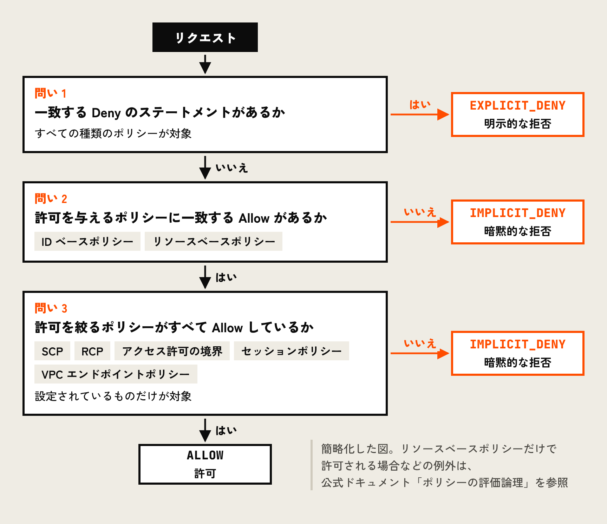
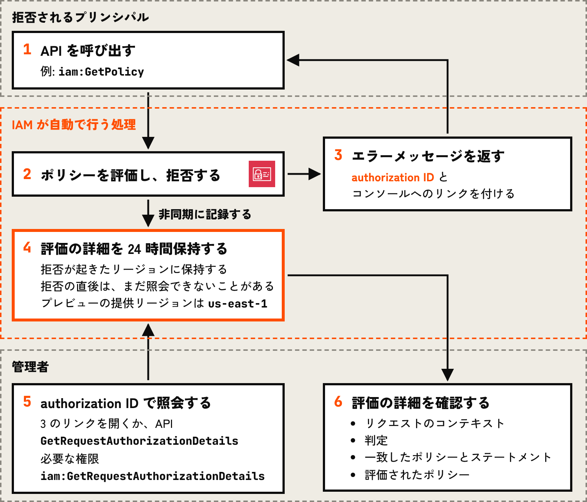
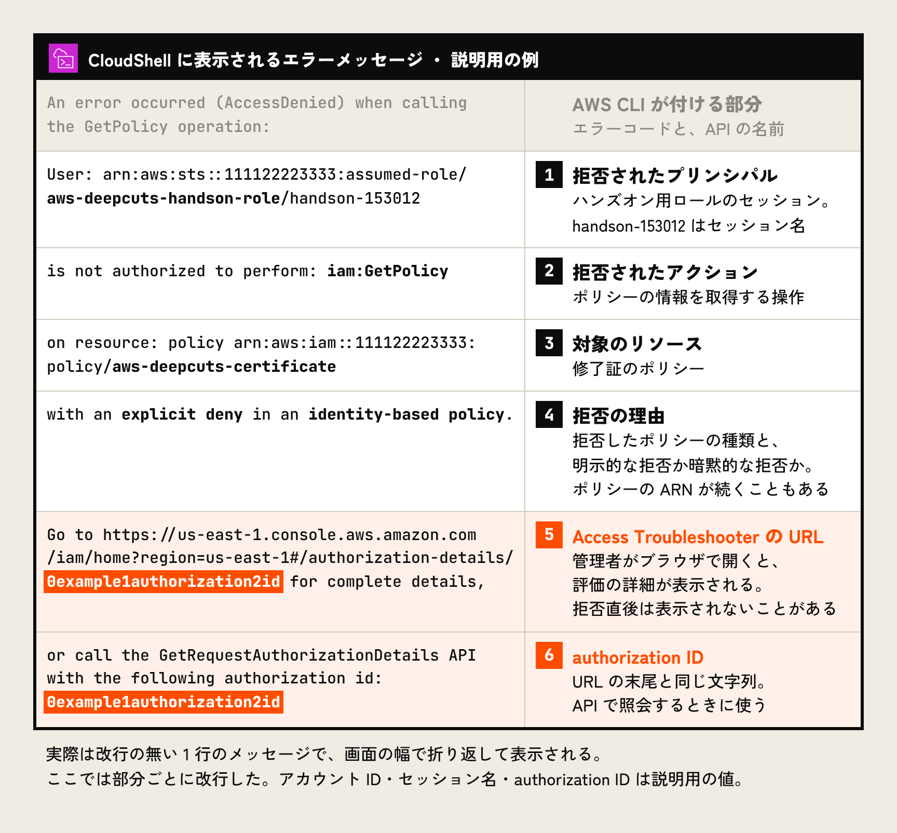
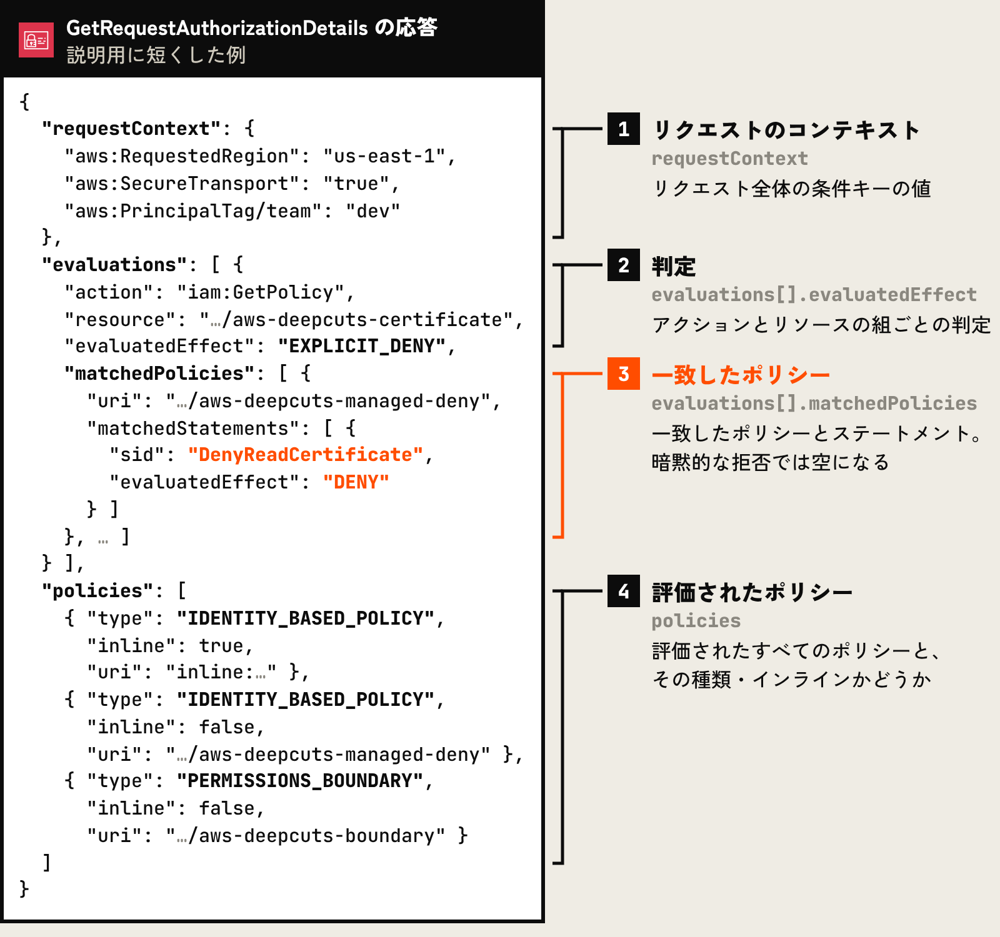
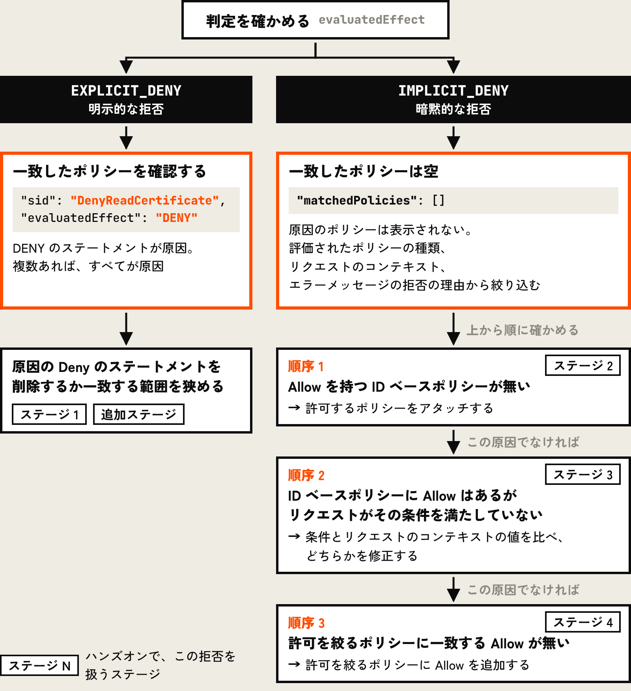
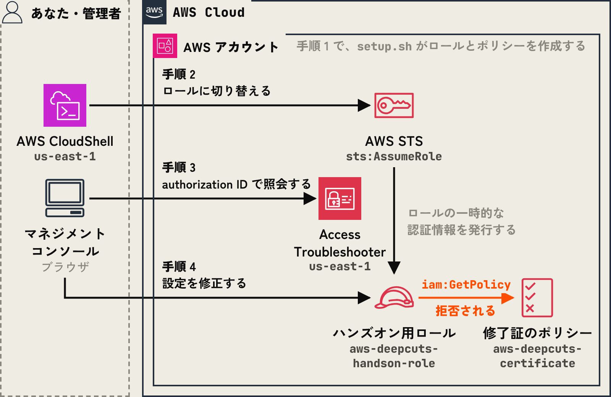

:::note info
AWS Deep Cuts の GitHub はこちらです。
https://github.com/AWS-Deep-Cuts/AWS-Deep-Cuts
:::

# AWS Deep Cutsとは？
AWS Deep Cutsは、AWS の最新のサービスやニッチな機能、または高度にアカデミックな知識を要求するサービスなど、多くの人が知らない 『隠れた名曲 = **Deep Cuts**』 を深くまで掘り下げる技術シリーズです。

このようなサービスはWeb情報も少なく、初学者は気軽にキャッチアップできないのが実情です。

そこで AWS Deep Cuts シリーズでは、**前提知識も含めた分かりやすいサービス解説** と **手順通りに進めれば誰でも再現できるハンズオン** を提供します！

# そもそもAccessDeniedの原因はなぜ分かりにくいのか？
IAM ロールにポリシーを追加して操作を許可したはずなのに、AWS の API を呼び出すと、まだ `AccessDenied` のエラーが返ることはありませんか？

`AccessDenied` は、IAM（AWS Identity and Access Management）がリクエストを拒否したときに返るエラーです。ロールに追加したポリシーが操作を許可していても、別のポリシーがその操作を拒否していたり、許可できる範囲を絞っていたりすると、IAM はリクエストを拒否します。このように、IAM がリクエストを許可するかどうかは 1 つのポリシーだけでは決まらないため、エラーの原因を特定するのは簡単ではありません。

AWS にリクエストを送る IAM ユーザーや IAM ロールを、**プリンシパル**と呼びます。プリンシパルの権限を決めるポリシーには、次の種類があります。

| ポリシーの種類 | 設定する場所 | 役割 | 分類 |
| --- | --- | --- | --- |
| ID ベースポリシー | IAM のユーザー、グループ、ロール | そのユーザーやロールに、操作を許可または拒否する | 許可を与える |
| リソースベースポリシー | S3 バケットなどのリソース | そのリソースへの操作を、誰に許可または拒否するかを定める | 許可を与える |
| アクセス許可の境界 | IAM のユーザー、ロール | そのユーザーやロールが行える操作の上限を定める | 許可を絞る |
| セッションポリシー | ロールに切り替える API の呼び出しで渡す | そのセッションで行える操作の上限を定める | 許可を絞る |
| SCP（サービスコントロールポリシー） | AWS Organizations の組織やアカウント | アカウント内のユーザーやロールが行える操作の上限を定める | 許可を絞る |
| RCP（リソースコントロールポリシー） | AWS Organizations の組織やアカウント | アカウント内のリソースに対して行える操作の上限を定める | 許可を絞る |
| VPC エンドポイントポリシー | VPC エンドポイント | そのエンドポイントを通る操作の上限を定める | 許可を絞る |

表のポリシーの種類を、すべて覚える必要はありません。押さえてほしいのは、ポリシーには「許可を与えるポリシー」と「許可を絞るポリシー」があり、IAM がそれらを決まった順序で評価して、許可か拒否かを決めることです。

表のセッションポリシーの「セッション」は、ロールに切り替えた後の操作を指します。プリンシパルがロールに切り替えると、AWS STS（AWS Security Token Service）が、そのロールの一時的な認証情報を発行します。この一時的な認証情報を使って行う一連の操作を、**セッション**と呼びます。セッションには、名前と、キーと値の組であるタグを付けられます。このタグを**セッションタグ**と呼びます。また、SCP と RCP を設定する AWS Organizations は、複数の AWS アカウントを 1 つの**組織**としてまとめて管理するサービスです。

IAM がポリシーを評価する順序を理解するために、まずポリシーの中身を確認します。次の JSON は、記事の最後で紹介するハンズオンで使うポリシー `aws-deepcuts-read-certificate` の内容です。アカウント ID は、説明用の値 111122223333 にしています。ポリシーは、作成のしかたによって、**管理ポリシー**と**インラインポリシー**に分かれます。管理ポリシーは、独立して作成し、複数のユーザーやロールにアタッチできるポリシーです。インラインポリシーは、1 つのユーザーやロールの中に直接書き込むポリシーです。このポリシーは管理ポリシーです。

```json
{
  "Version": "2012-10-17",
  "Statement": [
    {
      "Sid": "AllowReadCertificateForSecurityTeam",
      "Effect": "Allow",
      "Action": "iam:GetPolicy",
      "Resource": "arn:aws:iam::111122223333:policy/aws-deepcuts-certificate",
      "Condition": {
        "StringEquals": {
          "aws:PrincipalTag/team": "security"
        }
      }
    }
  ]
}
```

ポリシーは、`Statement` の中に 1 つ以上の**ステートメント**を並べたものです。ステートメントは、ポリシーの中の 1 つの規則です。この例のポリシーには、ステートメントが 1 つあります。

ステートメントのキーの意味は、次のとおりです。Resource には、AWS のリソースを一意に識別するための名前である ARN（Amazon Resource Name）を書きます。

| キー | 書く内容 | この例の値 |
| --- | --- | --- |
| `Sid` | Sid（Statement ID）は、ポリシーの中のステートメントを区別するために付ける ID です | `AllowReadCertificateForSecurityTeam` |
| `Effect` | 許可するか拒否するかを表します。値は Allow か Deny で、この値をステートメントの**効果**と呼びます | `Allow` |
| `Action` | 対象の操作を表します。サービスの名前と操作の名前をつなげた**アクション**を書きます | `iam:GetPolicy`。IAM のポリシーの情報を取得する操作を表します |
| `Resource` | 対象のリソースを表します | 管理ポリシー `aws-deepcuts-certificate` の ARN |
| `Condition` | 必要に応じて条件を書きます。リクエストの情報を表す**条件キー**と、条件キーの値と比べる値を書きます | 条件キー `aws:PrincipalTag/team` の値が `security` であること |

Condition で使う条件キーには、たとえば送信元の IP アドレスを表す `aws:SourceIp` があります。この例の `aws:PrincipalTag/team` は、リクエストを送ったプリンシパルに付いているタグ `team` の値を表す条件キーです。つまり、このステートメントは、タグ `team` の値が `security` のプリンシパルに、`aws-deepcuts-certificate` の情報を取得する操作を許可する規則です。

IAM は、リクエストを受けると、各ステートメントがリクエストに**一致する**かどうかを確かめます。一致するとは、ステートメントの Action と Resource がリクエストの操作と対象に当てはまり、Condition があればその条件も満たすことを指します。この例のステートメントは、タグ `team` の値が `security` ではないプリンシパルからのリクエストには一致しません。

ステートメントは、許可を与えるポリシーにも、許可を絞るポリシーにも書きます。ポリシーの種類の表で「許可を与える」に分類した ID ベースポリシーにも、効果が Deny のステートメントを書けます。ただし、2 つの分類では、Allow の働きが異なります。許可を与えるポリシーの Allow は、操作を許可します。許可を絞るポリシーの Allow は、操作を許可するのではなく、許可できる範囲の上限を定めます。そのため、許可を絞るポリシーを設定した場合は、そのポリシーにも、リクエストに一致する Allow が必要です。

ここまでの語を使うと、IAM がポリシーを評価する順序は、簡略化して次の図のように表せます。図の問い 1〜3 は、下の説明の 1〜3 と対応しています。



1. どれか 1 つのポリシーに、リクエストに一致する Deny のステートメントがあれば、IAM はリクエストを拒否します。これを **明示的な拒否** と呼びます。
2. Deny が無くても、許可を与えるポリシーに一致する Allow のステートメントが無ければ、IAM はリクエストを拒否します。これを **暗黙的な拒否** と呼びます。
3. 許可を与えるポリシーに一致する Allow があっても、IAM は次に、設定されている許可を絞るポリシーを評価します。一致する Allow のステートメントが無いポリシーが 1 つでもあれば、IAM はリクエストを拒否します。これも暗黙的な拒否です。

この図と説明は簡略化したものです。正確な順序と、リソースベースポリシーが IAM ユーザーに直接許可を与える場合などの例外は、公式ドキュメント「ポリシーの評価論理」で確認してください。なお、図の `EXPLICIT_DENY`・`IMPLICIT_DENY`・`ALLOW` は、この記事で紹介する IAM Access Troubleshooter が、IAM の結論として表示する値です。

冒頭の「ロールにポリシーを追加して許可したはずなのに拒否される」場面は、この図に当てはめると説明できます。追加した Allow がリクエストに一致していなければ問い 2 で、他のポリシーに一致する Deny があれば問い 1 で、許可を絞るポリシーに一致する Allow が無ければ問い 3 で、IAM はリクエストを拒否します。`AccessDenied` は、この評価の最終的な結果です。どの問いで、どのポリシーによって拒否されたのかは、この結果だけでは分かりません。AWS は、拒否の原因の手がかりになる情報を、次の表のように少しずつエラーメッセージに加えてきました。

| 時期 | エラーメッセージで分かること |
| --- | --- |
| 2021 年 11 月〜 | 拒否の原因になったポリシーの種類が、対応するサービスから順に表示されるようになった。例: `with an explicit deny in a service control policy`、`because no identity-based policy allows the ... action` |
| 2026 年 1 月〜 | 同じアカウントか同じ組織の中のリクエストで、原因になったポリシーの ARN も表示されるようになった。対象は SCP、RCP、ID ベースポリシー、セッションポリシー、アクセス許可の境界。すべてのサービスとリージョンに順次展開されている |

それでも、エラーメッセージには限界があります。公式ドキュメントによると、複数の種類のポリシーが拒否している場合でも、エラーメッセージに含まれるのは、そのうち 1 種類だけです。また、どのステートメントが一致したのかも、ロールのタグや送信元の IP アドレスのような条件の評価に使われた値も、メッセージからは分かりません。

この限界を補うために、IAM は 2026 年 8 月から、対応している API で拒否したリクエストのエラーメッセージに **authorization ID** を付けるようになりました。authorization ID は、IAM が拒否したリクエストを 1 件ずつ識別する ID です。この ID で照会すると、IAM がそのリクエストをどう評価したかの記録を確認できます。この記録を、**評価の詳細**と呼びます。authorization ID で評価の詳細を照会するための機能が、次の章で説明する IAM Access Troubleshooter です。

# IAM Access Troubleshooterとは？
IAM Access Troubleshooter は、拒否された 1 つのリクエストについて、IAM がどのポリシーをどう評価したのかを表示する機能です。2026 年 8 月から、プレビューとして提供されています。公式ドキュメントによると、2026 年 10 月時点で authorization ID が付くのは、`GetPolicy` のような IAM のサービス自体の API の大半です。

この機能は、使う場所によって名前が異なります。

| 使う場所 | 名前 |
| --- | --- |
| マネジメントコンソール | Access Troubleshooter |
| API | IAM Toolbox の `GetRequestAuthorizationDetails` |
| AWS CLI | `aws iam-toolbox get-request-authorization-details` |
| IAM ポリシーのアクション | `iam:GetRequestAuthorizationDetails` |

API と AWS CLI では、この機能は IAM Toolbox という名前で提供されています。そのため、AWS CLI のコマンドは `aws iam` ではなく `aws iam-toolbox` で始まります。ただし、この API を呼び出す権限の名前は、IAM の `iam:GetRequestAuthorizationDetails` です。以降は、この機能を Access Troubleshooter と呼びます。

ここからは、リクエストが拒否されてから、原因を調べる人が評価の詳細を確認するまでの流れを説明します。この流れには、拒否されるプリンシパルの他に、原因を調べる人が登場します。この記事では、評価の詳細を照会する権限と、ポリシーを修正する権限を持つ人を、**管理者**と呼びます。拒否されたプリンシパルを使っていた人と管理者は、同じ人のことも、別の人のこともあります。

流れの全体は、次の図のとおりです。図の番号は、下の説明の番号と対応しています。



1. プリンシパルが、AWS の API を呼び出します。
2. IAM がポリシーを評価して、リクエストを拒否します。
3. IAM は、authorization ID と Access Troubleshooter の URL を付けたエラーメッセージを、プリンシパルに返します。
4. IAM は、エラーを返す処理とは別に、評価の詳細を、拒否が起きたリージョンに記録します。記録が終わるまでに、少し時間がかかることがあります。API リファレンスによると、記録された評価の詳細は、拒否から少なくとも 24 時間は照会できます。
5. 管理者は、3 の URL を開くか API を呼び出して、authorization ID で評価の詳細を照会します。照会には、`iam:GetRequestAuthorizationDetails` の権限が必要です。
6. Access Troubleshooter は、評価の詳細を、コンソールでは画面に表示し、API では応答として返します。管理者は、その内容を確認します。評価の詳細には、次の 4 つの項目が含まれます。
   - 条件の評価に使われた値の一覧である**リクエストのコンテキスト**
   - IAM の結論である**判定**
   - リクエストに一致したポリシーとステートメントを示す**一致したポリシー**
   - 評価の対象になったすべてのポリシーを示す**評価されたポリシー**

   各項目の読み方は、「仕組み：評価の詳細の読み方」の章で説明します。

3 のエラーメッセージを、具体的に確認します。公式ドキュメントによると、対応している API で拒否されると、通常は、エラーメッセージの最後に Access Troubleshooter の URL と authorization ID が付きます。

ここでは、記事の最後で紹介するハンズオンで表示されるエラーメッセージを例にします。ハンズオンでは、AWS CloudShell を使います。AWS CloudShell は、マネジメントコンソールにサインインしたユーザーの権限で、ブラウザから AWS CLI のコマンドを実行できる環境です。ハンズオンでは、説明文にハンズオンの修了証を書いた管理ポリシー `aws-deepcuts-certificate` を用意し、この説明文を読み取ることを目標にします。この記事では、このポリシーを**修了証のポリシー**と呼びます。ハンズオンの参加者は、CloudShell で IAM ロール `aws-deepcuts-handson-role` に切り替えてから、IAM の `GetPolicy` API で修了証のポリシーの情報を取得しようとします。このロールを**ハンズオン用ロール**と呼びます。このリクエストは、IAM に拒否されます。

このとき CloudShell には、AWS CLI が先頭に付ける `An error occurred (AccessDenied) when calling the GetPolicy operation:` に続けて、次の形のメッセージが表示されます。authorization ID、アカウント ID、セッション名は説明用の値です。

```text
User: arn:aws:sts::111122223333:assumed-role/aws-deepcuts-handson-role/handson-153012 is not authorized to perform: iam:GetPolicy on resource: policy arn:aws:iam::111122223333:policy/aws-deepcuts-certificate with an explicit deny in an identity-based policy. Go to https://us-east-1.console.aws.amazon.com/iam/home?region=us-east-1#/authorization-details/0example1authorization2id for complete details, or call the GetRequestAuthorizationDetails API with the following authorization id: 0example1authorization2id
```

メッセージの各部分の意味は、次の図のとおりです。



図の 4 の `with an explicit deny in an identity-based policy` は、ID ベースポリシーによる明示的な拒否であることを示します。この部分を、この記事では**拒否の理由**と呼びます。ID ベースポリシーに、リクエストに一致する Allow が無いことによる暗黙的な拒否の場合は、拒否の理由が `because no identity-based policy allows the iam:GetPolicy action` のような形になります。原因が管理ポリシーの場合は、`identity-based policy` の後ろに `: <ポリシーの ARN>` が付くことがあります。インラインポリシーには ARN が無いため、ARN は付きません。

このエラーメッセージだけでは分からないことを、Access Troubleshooter は補います。主な特徴は次のとおりです。

- **評価の詳細をポリシーとステートメントの単位で表示する**
  リクエストのコンテキスト、判定、一致したポリシーとステートメントの Sid、評価されたポリシーを表示します。
- **7 種類のポリシーを区別する**
  API の仕様では、評価されたポリシーの種類として、ID ベースポリシー、リソースベースポリシー、アクセス許可の境界、セッションポリシー、SCP、RCP、VPC エンドポイントポリシーの 7 種類が定義されています。評価の詳細には、ポリシーごとにこの種類が含まれます。そのため、ロールの設定を確認しても見つからないセッションポリシーや SCP による拒否も、ポリシーの種類と一緒に確認できます。
- **アクションとリソースの組ごとに判定を表示する**
  API の仕様では、評価の詳細には、アクションとリソースの組ごとの評価が 1 件ずつ含まれます。1 つの API の呼び出しで複数のアクションが評価された場合は、組ごとに判定が表示されます。

ただし、2026 年 10 月時点のプレビューには、次の制約があります。

- 2026 年 8 月 25 日の AWS SDK と AWS CLI の変更履歴によると、プレビューを提供するリージョンは、バージニア北部（us-east-1）だけです。公式ドキュメントは、対応する API とリージョンを順次広げていると説明しています。筆者が 2026 年 10 月に確認した範囲では、東京リージョンでの提供の発表は見つかりませんでした。
- 公式ドキュメントによると、対応している API でも、次のリクエストには authorization ID が付かないことがあります。
  - 評価の対象になるポリシーが多すぎて、IAM が評価の詳細を記録できないリクエスト
  - AWS のサービスがプリンシパルの代わりに行ったリクエスト
  - 認証情報を使わない匿名のリクエスト

IAM は、追加料金なしで使えるサービスです。Access Troubleshooter に固有の料金は、2026 年 10 月時点で、ドキュメントにも価格表にも載っていません。

# 仕組み：評価の詳細の読み方
エラーメッセージで authorization ID が分かったら、次は評価の詳細を照会して読みます。この章では、評価の詳細に何が含まれ、拒否の原因をどの順に探すのかを、API の応答の JSON を使って説明します。なお、公式ドキュメントによると、コンソールの画面でも、同じようにアクションとリソースの組ごとの評価を確認できます。

管理者は、次のコマンドで、エラーメッセージの authorization ID を指定して評価の詳細を取得します。このコマンドには、AWS CLI v2 の 2.36.31 以降が必要です。ID は、前の章のエラーメッセージの例と同じ説明用の値です。

```bash
aws iam-toolbox get-request-authorization-details \
  --authorization-id 0example1authorization2id --region us-east-1
```

この後の図は、応答の JSON の形を示すために、API の仕様をもとに作成した説明用の例です。図の値は、前の章のエラーメッセージの例で示した拒否について、評価の詳細を取得したときを想定しています。一部の値は「…」で省略しています。

図の値を読むために、ハンズオンでこの拒否が起きる設定を先に説明します。ハンズオン用ロールには、修了証のポリシーの読み取りを拒否するステートメントを持つポリシーが 2 つ設定されています。1 つはロールの中に直接書き込まれたインラインポリシーで、もう 1 つはロールにアタッチされた管理ポリシー `aws-deepcuts-managed-deny` です。`aws-deepcuts-managed-deny` の中で読み取りを拒否するステートメントの Sid は、`DenyReadCertificate` です。また、ハンズオン用ロールには、アクセス許可の境界として管理ポリシー `aws-deepcuts-boundary` が設定されています。ロールには、キーが `team`、値が `dev` のタグも付いています。



図のリクエストのコンテキストには、「そもそもAccessDeniedの原因はなぜ分かりにくいのか？」の章のステートメントの例で使った条件キー `aws:PrincipalTag/team` が含まれています。値は `dev` のため、このリクエストは、タグ `team` の値が `security` であることを求めるそのステートメントの Condition を満たしません。同じ図の `aws:RequestedRegion` は、リクエスト先のリージョンを表す条件キーです。`aws:SecureTransport` は、リクエストが TLS（Transport Layer Security）で暗号化された接続で送られたかどうかを表す条件キーです。リクエストのコンテキストに含まれる条件キーは、サービスとリクエストの種類によって異なります。

応答の `evaluations` は、アクションとリソースの組ごとの評価を並べた配列です。図の右の列と次の表にある `evaluations[]` は、この配列の各要素を表します。たとえば、`evaluations[].evaluatedEffect` は、各要素の中の `evaluatedEffect` です。

| 応答の項目 | この記事での呼び名 | 内容 | 原因を調べるときの使い方 |
| --- | --- | --- | --- |
| `requestContext` | リクエストのコンテキスト | リクエスト全体に共通する条件キーとその値。アクションとリソースの組ごとの値は、`evaluations[].context` に含まれる | ステートメントの Condition を、リクエストが満たしたかどうかを確かめる |
| `evaluations[].evaluatedEffect` | 判定 | アクションとリソースの組ごとの評価の結論。`ALLOW`、`EXPLICIT_DENY`、`IMPLICIT_DENY` のいずれか | 明示的な拒否か、暗黙的な拒否かを確かめる |
| `evaluations[].matchedPolicies` | 一致したポリシー | 評価で一致したポリシーと、一致したステートメントの Sid と効果 | 明示的な拒否の原因を確かめる。API リファレンスによると、暗黙的な拒否では一致したポリシーは返らない |
| `policies` | 評価されたポリシー | 評価の対象になったすべてのポリシー。ポリシーごとに、種類、インラインかどうか、ポリシーを識別する `uri`、アタッチされている先が含まれる | 暗黙的な拒否のときに、評価されたポリシーの種類から、Allow が足りない可能性のあるポリシーを絞り込む |

原因のポリシーの種類とアタッチされている先は、一致したポリシーと評価されたポリシーを突き合わせて確かめます。応答は、どちらの項目でも、各ポリシーを `uri` で識別します。一致したポリシーの `uri` と同じ `uri` を持つ評価されたポリシーを探すと、そのポリシーの種類と、アタッチされている先が分かります。

`uri` の値は、ポリシーの作成のしかたによって異なります。API の仕様では、管理ポリシーの `uri` はポリシーの ARN です。インラインポリシーは ARN を持たないため、`uri` には識別子が入ります。API リファレンスの例では、この識別子は、図の `inline:…` のように `inline:` で始まります。この識別子はポリシーの名前ではないため、インラインポリシーは、アタッチされている先と、一致したステートメントの Sid から特定します。

なお、ステートメントを並べたポリシーの内容を、この記事では**ポリシーの本文**と呼びます。IAM コンソールは、ポリシーの本文を JSON で表示します。応答には、このポリシーの本文は含まれません。ステートメントの中身は、そのポリシーを設定している場所で確認します。設定している場所は、ポリシーの種類の表の「設定する場所」の列のとおりです。たとえば、ID ベースポリシーとアクセス許可の境界は、IAM コンソールでポリシーを開いて確認します。

ここまでで、評価の詳細の 4 つの項目を確認しました。実際に原因を探すときは、まず判定を確かめます。判定によって、原因の探し方が変わるためです。次の図は、判定ごとの原因の探し方をまとめたものです。



- **判定が `EXPLICIT_DENY` のとき**
  一致したポリシーの中から、効果が `DENY` のステートメントを探します。一致したポリシーには、一致したステートメントごとに `evaluatedEffect` があり、そのステートメントの効果を `ALLOW` か `DENY` で表します。このキーは、判定を表すキーと同じ名前ですが、別の項目です。効果が `DENY` のステートメントが拒否の原因です。複数あれば、すべてが原因です。公式ドキュメントによると、明示的な拒否は、原因の Deny のステートメントを削除するか、そのステートメントが一致する範囲を狭めて解消します。
- **判定が `IMPLICIT_DENY` のとき**
  一致したポリシーは空になるため、評価の詳細には、原因のポリシーが表示されません。代わりに、次の表を上から順に確かめます。

| 順序 | 確かめること | 当てはまらない場合の原因 | 修正すること |
| --- | --- | --- | --- |
| 1 | 評価された ID ベースポリシーの中に、その操作を許可する Allow のステートメントがあるか。評価の詳細にはポリシーの本文が無いため、IAM コンソールでポリシーを開いて確かめる | 許可するポリシーが無い | その操作を許可する Allow のステートメントを持つポリシーをアタッチするか、ポリシーに追加する |
| 2 | 順序 1 で見つけた Allow のステートメントに Condition があれば、その条件を、リクエストのコンテキストの値が満たしているか | 条件を満たしていない | ポリシーの Condition を修正するか、ロールのタグなど、リクエストの側の設定を修正する |
| 3 | 許可を絞るポリシーにも、その操作に一致する Allow のステートメントがあるか | 許可を絞るポリシーに、一致する Allow が無い | そのポリシーに Allow を追加する |

暗黙的な拒否では、エラーメッセージの拒否の理由も、原因を絞り込むのに役立ちます。たとえば、拒否の理由が `because no identity-based policy allows` であれば、原因は上の表の順序 1 か 2 で見つかります。拒否の理由が `because no permissions boundary allows` であれば、原因はアクセス許可の境界で、表の順序 3 に当たります。ただし、先に説明したとおり、複数の種類のポリシーが拒否している場合でも、エラーメッセージに含まれるのは、そのうち 1 種類だけです。そのため、順序 1 か 2 の原因を修正した後に、順序 3 の原因で拒否されることもあります。

:::note info
**図のステージの印**
図は、記事の最後で紹介するハンズオンとの対応も示しています。ハンズオンでは、4 種類の拒否の原因を 1 つずつ特定して解消し、1 つの原因を特定して解消するまでを 1 つのステージと呼びます。図の「ステージ」の印は、印を付けた原因による拒否を、ハンズオンのどのステージで扱うかを示します。追加ステージは、セッションポリシーによる拒否を扱う任意のステージです。
:::

:::note info
**authorization ID だけでは評価の詳細を確認できない**
authorization ID はエラーメッセージに表示されますが、評価の詳細を照会するには `iam:GetRequestAuthorizationDetails` の権限が必要です。拒否されたプリンシパルにこの権限が無ければ、そのプリンシパルの認証情報では、評価の詳細を照会できません。

AWS は、サービスごとのアクションと、各アクションの Resource に指定できるリソースの種類を、公式ドキュメント「サービス認可リファレンス（Service Authorization Reference）」にまとめています。2026 年 10 月時点で、このリファレンスには `iam:GetRequestAuthorizationDetails` が載っておらず、Resource に指定できるリソースの種類が定められていません。そのため、この権限を許可するポリシーでは、Resource に `*` を指定します。

公式ドキュメントによると、この権限を持つプリンシパルは、拒否されたリクエストと同じアカウントか同じ組織に属していれば、他のプリンシパルが受けた拒否についても、評価の詳細を照会できます。
:::

# IAM Access Troubleshooterの主な活用事例
ここまでで、評価の詳細から拒否の原因を探す方法を説明しました。評価の詳細は、1 件の拒否の原因を調べる他にも、次のような場面で使えます。いずれも、公式ドキュメントの説明をもとに筆者が考えた使い方です。

- **開発者からの権限の依頼を具体的にする**
  開発者に照会の権限を付与しておけば、開発者からの依頼は「権限が無いので付けてください」から、「管理ポリシー `deny-prod-iam-write` の Sid `DenyRoleChanges` に拒否されています。このステートメントの対象から、開発用のロールを外してください」のような具体的な依頼に変わります。管理者が、すべてのポリシーを読み直す手間が減ります。ポリシーと Sid の名前は、説明用の例です。
- **許可を絞るポリシーが意図どおりに機能しているかを確かめる**
  SCP、アクセス許可の境界、セッションポリシーのような許可を絞るポリシーが、意図どおりに機能しているかを、実際の拒否で確認できます。
- **条件キーの実際の値を確かめる**
  Condition に `aws:SourceIp` などの条件キーを使った Allow のステートメントが、リクエストに一致しないことがあります。そのようなときに、リクエストのコンテキストで、リクエストに含まれていた条件キーの実際の値を確認できます。
- **照会を管理者に引き継ぐ**
  拒否されたプリンシパルに照会の権限が無くても、そのプリンシパルを使っていた人が authorization ID を管理者に伝えれば、照会の権限を持つ管理者が同じ評価の詳細を確認できます。照会できるのは、管理者が使うプリンシパルと同じアカウントか同じ組織の中で起きた拒否です。拒否からいつまで照会できるかは、ベストプラクティスの章で説明します。

# IAM Access Troubleshooterを使う際のベストプラクティス
最後に、ここまでに説明した仕組みと制約を踏まえて、Access Troubleshooter を使うときの注意点をまとめます。公式ドキュメントに基づく項目には、「公式ドキュメントによると」または「API リファレンスによると」と書いています。それ以外の項目は、筆者の考えです。

- **エラーメッセージを最後まで読む**
  authorization ID と Access Troubleshooter の URL は、メッセージの最後にあります。CLI ではメッセージが長く表示されるため、見落としやすくなります。
- **拒否から 24 時間以内に同じリージョンで照会する**
  API リファレンスによると、評価の詳細は、拒否から少なくとも 24 時間は照会できます。それより後も照会できるとは限らないため、拒否から 24 時間以内に照会します。照会は、拒否が起きたリージョンで、拒否されたリクエストと同じアカウントか同じ組織に属するプリンシパルから行います。また、評価の詳細は、エラーを返す処理とは別に、少し遅れて記録されます。そのため、拒否の直後に照会すると、`ResourceNotFoundException` が返ることがあります。その場合は、少し待ってから照会し直します。
- **照会の権限を誰に付与するかを決めておく**
  評価の詳細には、評価されたポリシーの種類、管理ポリシーの ARN、ポリシーがアタッチされている先と、リクエストのコンテキストの値が含まれます。「仕組み：評価の詳細の読み方」の章の注記で説明したとおり、照会の権限を持つプリンシパルは、他のプリンシパルが受けた拒否についても評価の詳細を照会できます。つまり、他のプリンシパルについても、どのポリシーがどこにアタッチされているかと、リクエストのコンテキストの値を確認できます。一方で、「IAM Access Troubleshooterの主な活用事例」の章で紹介したように、開発者に照会の権限を付与すると、開発者からの権限の依頼が具体的になります。開発者にも付与するか、管理者だけにするかを、社内の方針として決めておきます。
- **意図どおりの拒否もあることを忘れない**
  拒否の原因は、ポリシーの誤りとは限りません。公式ドキュメントによると、原因がポリシーではなくリクエストのコンテキストにあり、拒否そのものは正しいこともあります。この場合に修正すべきなのは、ポリシーではなく、リクエストの側です。たとえば、次の場合は、IAM はポリシーの意図どおりにリクエストを拒否しています。
  - 付けるはずのセッションタグが、セッションに付いていない場合
  - リクエストが想定外のネットワーク経路から送られている場合

# ハンズオンはこちら！
ここまでに説明した読み方は、ハンズオンで実際に確かめられます。ハンズオンでは、4 種類の拒否の原因を、4 つのステージで 1 つずつ特定して解消します。「IAM Access Troubleshooterとは？」の章で説明したとおり、2026 年 10 月時点で authorization ID が付くのは、IAM のサービス自体の API の大半です。そのため、ハンズオンの題材は、IAM の `GetPolicy` API で修了証のポリシーの説明文を読み取る操作です。

事前準備のスクリプト `setup.sh` は、修了証のポリシーとハンズオン用ロールを作成し、このロールで読み取りが拒否される原因を 4 種類用意します。拒否されるプリンシパルを使う人と管理者は、どちらもあなたです。あなたは、ハンズオン用ロールに切り替えて読み取りを試し、拒否されるたびに、管理者として Access Troubleshooter で原因を特定して、IAM コンソールで設定を修正します。ハンズオンは、CloudShell とマネジメントコンソールだけで実施でき、作成するのは IAM のロールとポリシーだけです。



図の手順の番号は、ハンズオンの README の手順の番号です。

https://github.com/AWS-Deep-Cuts/aws-iam-toolbox

# まとめ
Access Troubleshooter を使うと、明示的な拒否では原因のポリシーとステートメントを、暗黙的な拒否では評価されたポリシーとリクエストのコンテキストを確認でき、`AccessDenied` の原因を絞り込めます。評価の詳細を、IAM がポリシーを評価する順序と照らし合わせて読むと、評価の仕組みの理解も深まります。プレビューで制約はありますが、IAM の権限で困ったことがある方は、ぜひ一度 authorization ID を照会してみてください！

---

参考文献
1. [authorization ID を使ってアクセス拒否のエラーを調べる（Troubleshoot access denied error messages with authorization ID (Preview)）](https://docs.aws.amazon.com/IAM/latest/UserGuide/troubleshoot_access-denied-authorization-id.html)
1. [GetRequestAuthorizationDetails の API リファレンス（IAM Toolbox API Reference）](https://docs.aws.amazon.com/iam-toolbox/latest/APIReference/API_GetRequestAuthorizationDetails.html)
1. [AWS CLI v2 の変更履歴（AWS CLI v2 CHANGELOG）](https://github.com/aws/aws-cli/blob/v2/CHANGELOG.rst)
1. [ポリシーの評価論理（Policy evaluation logic）](https://docs.aws.amazon.com/IAM/latest/UserGuide/reference_policies_evaluation-logic.html)
1. [アクセス拒否のエラーメッセージのトラブルシューティング（Troubleshoot access denied error messages）](https://docs.aws.amazon.com/IAM/latest/UserGuide/troubleshoot_access-denied.html)
1. [AWS Identity and Access Management により、AWS のアクセス拒否のエラーを効率よく調べられるようになった（AWS Identity and Access Management now makes it more efficient to troubleshoot access denied errors in AWS）](https://aws.amazon.com/about-aws/whats-new/2021/11/aws-identity-access-management-efficient-troubleshoot-error/)
1. [アクセス拒否のエラーメッセージへのポリシーの ARN の追加（AWS What's New, 2026 年 1 月）](https://aws.amazon.com/about-aws/whats-new/2026/01/additional-policy-details-access-denied-error/)
<!-- 要確認: 公開前に、この What's New のページで英語の原題を確かめる。日本語訳を原題の訳に合わせ、括弧の中の「AWS What's New, 2026 年 1 月」を英語の原題に置き換えて、他の参考文献と同じ「日本語訳（英語の原題）」の形にそろえる。原題は調査の記録に無いため、推測で書かない -->
